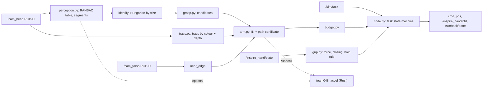

<p align="center">
  
  &nbsp;
  
  &nbsp;
  
  &nbsp;
  
  &nbsp;
  
</p>

<p align="center">
  
</p>

[Русский](README.md) | English

# DeftSort

The task: ROS Humanoid Hack, manipulation track. A TienKung 2.0 Pro humanoid with Inspire hands stands at a table in Isaac Sim 5.0 / Isaac Lab 2.2. Objects of three categories lie on the table next to coloured trays. Each object goes into its category's tray: `sort2` (2 categories, 270 s) and `sort3` (3 categories, 405 s) on pool 3 (dish / box / jar), with `sort2` on pool 6 as a bonus. Time is simulation time and start-up counts. An object in its tray scores +10; one lifted and left outside its tray, or still in the hand at the end, scores −10; an untouched one scores 0 (#595). Simulator object poses are off limits, scene coordinates may not be hard-coded (#645), and self-collision is checked (#625).

DeftSort is a single Python ROS 2 node that, for each layout, finds the table and trays with the robot's own cameras, segments and identifies the objects, plans each grasp and placement with a collision certificate over the whole path (arm, torso, other arm, table, tray walls), and decides whether the object can still reach its tray before the limit. No neural networks: geometry, RANSAC, the Hungarian algorithm, DLS IK and a sphere model of the robot. The numeric kernels are mirrored in the Rust module `team048_accel`. On all 62 recorded frames in the target environment (Python 3.10, NumPy 1.26) deprojection, table plane, trays and segments are bit-identical to the NumPy reference; segment features, candidates and plans differ by at most 2.3e-14, with no discrete differences.

| Stage | Question | DeftSort |
|---|---|---|
| Scene | Where are the table and trays? | RANSAC plane from head depth, near edge from the torso camera, trays by `/sim/task` colour plus depth |
| Perception | What is where? | Segments above the plane, assigned to `/sim/task` objects by size (Hungarian), abstaining on a small cost margin |
| Grasp | How to take it? | Side grasp across the narrow axis, rim pinch on open dishes, top-down; two-phase closing per #648 |
| Motion | Will it hit itself or the table? | URDF IK and a joint-space path certificate over spheres; torso as 64 mesh-fitted spheres |
| Time | Will it finish in time? | Budget on `/clock`; a carry-or-release check before the lift |

> This is the team 048 working repository. The entry itself is submitted separately to the organisers' team repository.

## Status

Scores in the simulator are not yet stable. Offline tests pass. The v12 and v13 changes are checked only on CPU: replay of recorded frames and logs, stress and regression tests. No GPU quota is left before 14.11.

- Tests: 190. With the Rust module and the v7 frames all 190 pass; without the v7 frames 174 pass and 16 are skipped; with `TEAM048_ACCEL=0` 167 pass and 23 are skipped (the Rust ↔ NumPy equivalence tests). Fixtures come from Kaggle runs: RGB-D frames, grasp TRACEs, simulator logs.
- Last run, v11b (`sort2`, seed 101, commit `497471e`): 0 of 6 in trays. The force limit reached both hands and Threshold was skipped, but Utana slipped during the carry and stayed on the table (from the frames, likely −10). The simulator did not answer `/sim/task/check`, so there is no exact score. The run before, v9b on `f525ed9`: 10 points (Perricone).
- Objects of 0.22 kg and more were held 0 of 6 times in v7 and v8, so they go last.
- Test tubes are not attempted: the node publishes `/sim/task/done` right away (0 points, allowed by the rules).

| Run (Kaggle T4, RTF ≈ 0.21) | Code | Result | Finding |
|---|---|---|---|
| v6, sort3 × 3 seeds | early | +10 on one seed | First frame taken before the head settled; no release pose for the right tray |
| v7, sort3 | v6 fixes | +10 on one seed | Table tilted 4° in the pelvis frame; thumb missing from the collision model, side grasps pressed into the table |
| v8, sort3 seed 103 | yaw placing, new table | 10 (Perricone) | 4 of 5 approaches touched the object; Utana and mustard slipped on the lift (force 1.0) |
| v9a, sort3 seed 103, self-collision ON | compliance + Rust merge | 0 | Went home before measuring the table and swept through its edge (\|F\| up to 938 N); torso missing from the model |
| v9a, sort3 seed 103 | `f525ed9` | did not start | Camera frames began 1115 s after the bridge started, but the harness never received `/sim/task` via `ros2 topic echo` within 1512 s |
| v9b, sort2 seed 101 | `f525ed9` | 10 (Perricone) | The force limit reached the right hand only; Threshold is closed on top and all 4 rim pinches hit it with the thumb |
| v11b, sort2 seed 101 | `497471e` | 0 in trays, likely −10 | Force 0.4 on both hands, Threshold skipped; Perricone slipped on the lift (same plan as v9b); Utana held on the lift and dropped during the carry |

## Architecture



## One layout, step by step

1. `run.sh` starts the node with `use_sim_time:=true`; `t0` charges the `run.sh` process age pessimistically (RTF ≤ 1). Non-sort tasks get `/sim/task/done` at once.
2. `/robot_description` is used when it carries every needed link, otherwise the organiser's URDF copy.
3. Hands: `set_force` 0.4 and `set_speed` 0.5 go to each hand right after start, before `/sim/task`. A background thread waits for each service, re-sends until it answers (up to 5 sends, 2 s apart) and logs the outcome per hand. An arm whose hand never got the force limit is not used. Then the hands open with the thumb in opposition.
4. Survey before any arm motion: head pitch 0.4 rad, yaw 0 / +0.6 / −0.6 rad; table plane by RANSAC in a height window, trays re-shot with a head turn when cut by the frame border, near edge from the torso camera.
5. Home along a certified path against the measured table: `certify_escape` when the start pose already touches the model, `roadmap_path` (lazy Dijkstra over a shoulder × abduction × elbow grid) when the straight path fails.
6. Loop: time-synced RGB-D frame after motion stops, segments, identification, light objects first (< 0.22 kg from `objects.yaml`), grasp candidates, pick and place plan (with torso yaw when needed), budget check.
7. Guarded approach (0.3 rad/s last leg), thumb, two-phase closing, empty check without lifting, time re-check, lift, carry, release, retreat.
8. Up to two failures per object, then one retry round if time allows; home, torso to 0, `/sim/task/done`, a `done at … reason: …` log line.

## Motion safety

- `certify` checks the joint-space path over spheres and skips a step only when the clearance provably holds; margin 0.015 m.
- The model covers arm segments, mesh-fitted thumb spheres, the torso column, 64 torso spheres fitted to the `waist_yaw_link` mesh (39 / 42 kept per side after removing the shoulder mount), head, hips, the other arm at its measured posture, the measured table and tray walls, and non-adjacent intra-chain pairs.
- The table model never bulges past the measured edge: R = 0.1 spheres start at edge + R, edge spheres r = 0.025, front face as a column down to 0.35 m below the top.
- `certify_escape` is a MoveIt `FixStartStateCollision` analogue: pairs touching at the start may only separate (1 mm tolerance), all others go through `certify`.
- Arms never move simultaneously, so the other arm's posture is static.
- Measured cost of the torso model: 7.33 reachable objects per layout vs 8.31 without it (100 pool-3 `sort3` layouts).

## Grasping and time

- #648: force 0.4 and speed 0.5 on both hands, thumb first, phase 2 targets the measured contact minus `CLOSE_PAST` 0.15 of the stroke.
- Rim pinches are planned only on open dishes (`grasp.rim_closed`): Threshold shows 622–677 points at rim height inside the rim circle in every v7, v8 and v9b frame, open dishes 0–6. In v9b all 4 Threshold approaches tripped the thumb guard 0.4–1.0 mm from the closed top.
- Rim pinch only when the gravity torque m·g·r ≤ 0.17 N·m (`grasp.RIM_TORQUE_MAX`; m from `objects.yaml` for the identified object, r = measured rim radius). Runs: Ecoforms (0.05 N·m) held 2 of 2, Threshold (0.11) 1 of 3, Utana (0.21–0.22 in replay) 0 of 7. Dishes above it are skipped: 0 points instead of a −10 risk.
- Every outcome ends the same way (v13): an exception inside `pick_place` opens both hands and sends the arms home, and the run goes on; at the end the lift, the way home and the waist reset run one by one, and `/sim/task/done` is always published. A failed observation is retried once instead of ending the run. The RGB-D pair buffer is locked against the camera callback threads.
- A rim-held dish is placed by its centre, not by the pinch point (`node.held_offset`). Before, the centre hung 5–6.6 cm off the slot; in the middle slot an Ecoforms-size dish crossed the tray wall by 1.5 cm (`test_v12.py`).
- Empty grasps are detected before the lift (`contact_empty` 0.10); approach guard `GUARD_DEV` 0.16 keeps 4/4 holds and catches at least 10/12 failed approaches in v7 + v8; hold rule: deviation ≥ 0.10 and effort ≥ 0.9.
- Physics: at force 0.4 the saturated finger drive gives at least 80 N per finger, so μ ≈ 0.03 suffices for the heaviest pool object (0.43 kg). Slips come from contact geometry, not friction.
- Budget: `can_start` with `SAFETY_S` 8 s, `FIRST_CYCLE_S` 35 s, `PLACE_TAIL_S` 12 s; `place_time` includes the lift and `MOVE_SETTLE_S` 2.6 s per move (old model: 6.6 s vs 12.0 s measured on v8). If the carry would not fit, the hand opens in place.

## Rust acceleration

`rust/team048_accel` 0.2.0 (PyO3 0.30 abi3-py310, nalgebra 0.35, rayon).

| Measurement (master `d96da87`) | NumPy reference | Rust | Speed-up |
|---|---:|---:|---:|
| Perception, ms per frame | 146.7 | 47.9 | 3.1× |
| Planning 10 objects, s | 0.672 | 0.374 | 1.8× |

Equivalence is tested in `test_accel_equivalence.py` and `test_accel_phase2.py`: bit-exact except one segment-height quantile (≤ 1e-12, FMA in NumPy's BLAS), deprojection (≤ 1e-12, depends on the CPU's OpenBLAS kernel) and IK solutions (≥ 99.5 % of random targets agree to 1e-9; otherwise both branches must reach the target). Any import failure or error falls back to NumPy for the rest of the process. `vendor/` ships a SHA256-checked manylinux2014 abi3 wheel; `setup.sh` builds from source otherwise and never fails.

## Install, run, test

```bash
pip install -r requirements.txt && bash setup.sh && colcon build && source install/setup.bash   # install order of the format: apt, pip, setup.sh, colcon
bash run.sh
python3 -m pytest -q                  # from the repo root (pytest.ini)
TEAM048_ACCEL=0 python3 -m pytest -q
```

Env: `TEAM048_HAND_FORCE` (0.4), `TEAM048_HAND_SPEED` (0.5), `TEAM048_CLOSE_PAST` (0.15), `TEAM048_ACCEL` (1), `TEAM048_ACCEL_PARALLEL` (0).

## Limits and roadmap

| Area | Now | Next |
|---|---|---|
| Simulator validation | v11b confirmed force on both hands and the Threshold skip; v12 not run on GPU | `sort2` seed 101 after the quota reset: Utana skipped, Ecoforms placed by its centre |
| Heavy objects | 0/6 holds from 0.22 kg | Three-finger or bottom-wall grasp |
| Heavy dishes | Utana (0.21–0.22 N·m) is no longer attempted: 0 of 7 pinches, one likely −10 | Grasp at the base wall or with three fingers |
| Neighbours | In v9b and v11b Ecoforms and Crunch toppled after the Ecoforms contact (up to 26 N at the wrist); in v11b the left arm pushed Utana off the tray edge onto the table. Objects in or on trays are not in the collision model | Envelope of placed objects |
| Dropped object | An object dropped during the carry counts as placed and is not retried; the empty-hand signal over the tray is unreliable (v9b Perricone landed in the tray with an 'empty' verdict) | Needs drop data |
| Torso model | −1 object per layout | Torso-only pad/margin after checking |
| Pool 6 | Razer mouse (10.0 cm) and gelatin box (8.9 cm) wider than the 7.8 cm pinch opening | Separate grasp strategy |
| Test tubes | Immediate `/sim/task/done` | After sorting is stable |
| Payload | Held object not in the collision model | Payload envelope during carry |

Details (Russian): [docs/ARCHITECTURE.md](docs/ARCHITECTURE.md), [docs/COMPLIANCE.md](docs/COMPLIANCE.md), [docs/ORG_ANSWERS.md](docs/ORG_ANSWERS.md), [docs/PARAMETERS.md](docs/PARAMETERS.md), [docs/MATH_PHYSICS.md](docs/MATH_PHYSICS.md) (frames, grasp model, torque gate, IK, collisions, time budget).

## Licences

Team code: Apache-2.0, full text in `LICENSE` (also declared in `package.xml`, `Cargo.toml`). The URDF is from the simulator repository (Apache-2.0, UBTECH / N. Semenov); torso and thumb spheres are fitted offline to UBTECH tiangong2pro_tf STL meshes (Apache-2.0). No third-party code was copied.
