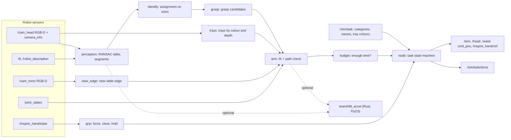
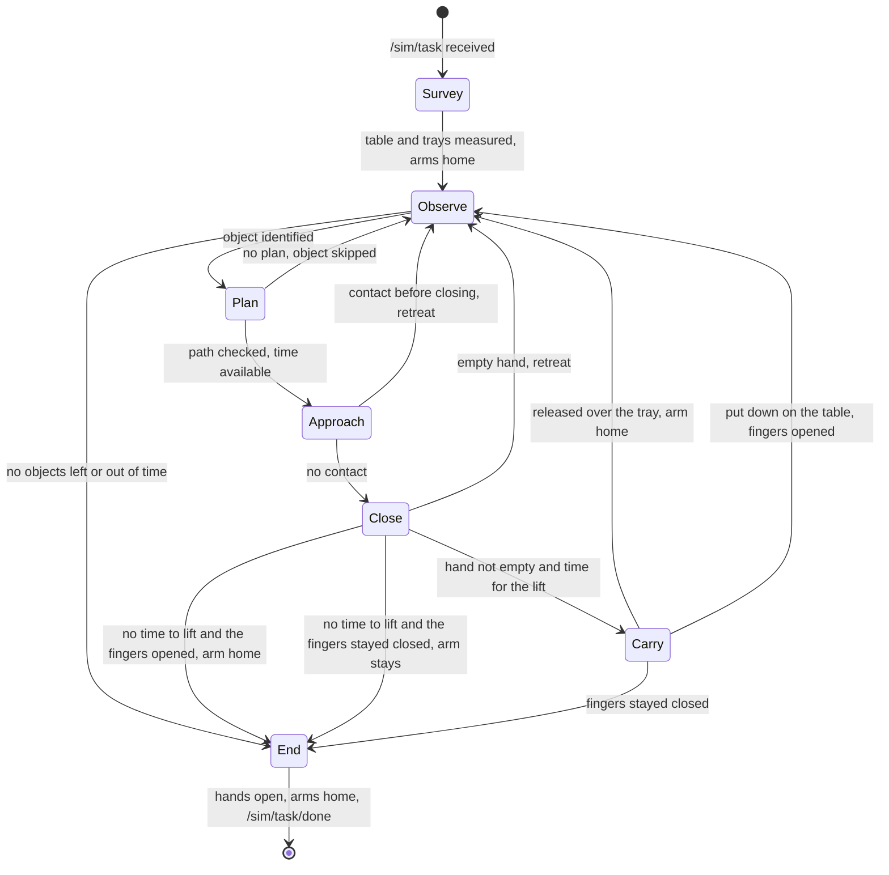
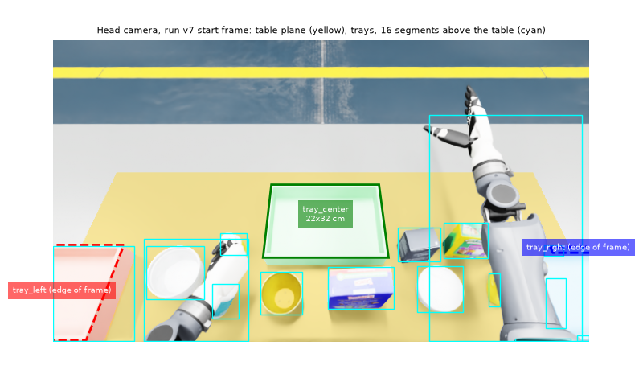
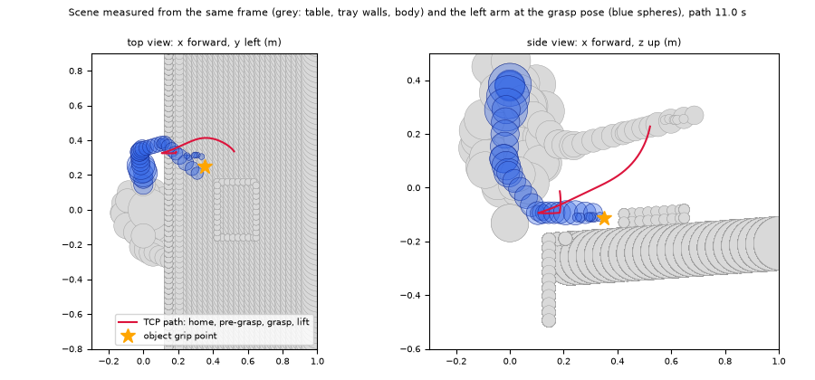

<p align="center">
  
  &nbsp;
  
  &nbsp;
  
  &nbsp;
  
  &nbsp;
  
  &nbsp;
  
</p>

[Русский](README.md) | English

# DeftSort

[Strengths](#key-strengths) · [What works](#what-already-works) · [Run](#run) · [How it works](#how-it-works) · [Method sources](#where-the-methods-come-from) · [Scope](#scope) · [Hard questions](#hard-questions) · [Documents](#documents) · [Licence](#licence)

A TienKung 2.0 Pro humanoid with Inspire hands stands at a table. The objects go into the trays of their categories within 270 s (`sort2`) or 405 s (`sort3`) of simulation time. Where the table and the trays are and what lies on the table, the robot learns from its own cameras only.

**Task.** ROS Humanoid Hack, manipulation track: Isaac Sim 5.0 / Isaac Lab 2.2, team 048.

**What DeftSort does.** One ROS 2 node in Python takes every object through one chain:

1. **See.** The table, the trays and the objects are measured with the head and torso cameras. The code holds no scene coordinates.
2. **Choose a grasp.** The object is identified by its size from `/sim/task`; a side, top-down or rim grasp is built from the point cloud.
3. **Check the path.** The arm path to the object and to the tray is checked for collisions with a sphere model of the robot and the measured scene.
4. **Lift with time to spare.** A lift is allowed if the hand is not empty and the remaining time covers the worst-case carry. Otherwise the hand opens. Fingers that open: the arm goes home. The episode ends, and the next object is not started.

**Why it scores.** Points come from objects in their own trays, and an object lifted but not delivered costs −10. DeftSort lifts an object only when it has a checked path and the time to deliver it. Every lift aims at +10; a doubtful case costs 0.

**Stage.** Hackathon prototype. The build is verified offline: 290 tests on recorded frames and logs of our runs in the organisers' simulator.

## Key strengths

- **Robot sensors only.** No scene coordinates in the code: AST tests check every subscription, publisher, import and scene layout literal ([test_compliance.py](src/team048_solution/test/test_compliance.py), [test_rules_edges.py](src/team048_solution/test/test_rules_edges.py)).
- **The whole arm path is checked.** Spheres for the arm, the torso (fitted to its mesh), the head and the other arm in its measured pose; check step ≤ 0.003 rad with every sphere inflated by the joint travel. A pair that is clear at the start stays clear on the whole segment, including the way home from the start posture. A torso turn with the object in hand is checked over the whole arc, and the table and trays stay in the pelvis frame during the turn ([planning.py](src/team048_solution/team048_solution/planning.py), [test_start_posture.py](src/team048_solution/test/test_start_posture.py)).
- **Lift only with time to spare.** An object is lifted only if the remaining time covers the worst-case holding time: lift, carry, torso turn, placing with a correction, the re-approach to the tray with its correction and the release, each step up to its timeout. Otherwise the hand opens, the object stays on the table, and the episode ends. A hand that still reads closed is not taken home from that pose ([test_hold_time.py](src/team048_solution/test/test_hold_time.py), [test_compliance.py](src/team048_solution/test/test_compliance.py)).
- **Rust accelerator, same answers.** On 62 frames from our runs (the frames are not in the repository) perception is bit-identical to NumPy and the discrete decisions match in all 5358 records. Perception runs 15x faster, grasp planning 223x ([benchmark](#rust-accelerator); [test_accel_equivalence.py](src/team048_solution/test/test_accel_equivalence.py), [test_accel_kernels.py](src/team048_solution/test/test_accel_kernels.py)).
- **Force within the rules.** All six `SetForce` channels of both hands are within 0.3–0.5: 0.4 on the squeezing fingers, 0.5 on thumb rotation; any override is clamped to 0.3–0.5 ([test_rules_edges.py](src/team048_solution/test/test_rules_edges.py), [test_hand_settings.py](src/team048_solution/test/test_hand_settings.py), [docs/COMPLIANCE.md](docs/COMPLIANCE.md#захват-648)).
- **290 offline tests without ROS.** The node runs on stubs with real simulator frames; one command checks everything: `bash tools/verify.sh`.

## What already works

- **Perception.** RANSAC table plane, near table edge from the torso camera, trays by colour and depth with measured size, axis and wall height. Objects are identified by size: segments and task objects are matched as an assignment problem. The number of RANSAC samples grows when the table covers a small share of the frame.
- **Grasping.** Three kinds: side, top-down and a rim pinch on open dishes. The grasp centre is shifted so the open hand clears the object on the way in. A grasp that was executed and failed goes last among the candidates on the next try.
- **Hand.** Two-phase close: to contact, then 0.15 of the stroke further. Before the lift the node checks that the hand is not empty.
- **Placing.** The hand opens when the TCP is within 4 cm of the plan or the release point lies inside the measured tray rectangle. Otherwise one more approach. If the point is still outside the tray, the object is carried back to the table only when the remaining time minus 8 s covers the worst-case return; otherwise the hand opens where it is. A transfer counts only if the hand is not empty over the tray and the fingers do not stay closed after the release. Fingers that stay closed stop the run.
- **Time.** Budget on `/clock`, launch time included; light objects first.
- **Robustness.** An error on one object opens the hands and returns the arms home; the run goes on. If the fingers still read closed after a release, the run stops before the next object; at the end the hands open again, and only then do the arms go home. ROS callbacks drop malformed messages and log them; an invalid task on `/sim/task` is skipped and the node waits for the next one. `/sim/task/done` is published once at the end of the run, also after a setup error and after an error outside the task loop.

## Run

Needs ROS 2 Humble, Python 3.10 and the `bodyctrl_msgs` message package from the organisers' simulator. From the clone root:

```bash
pip install -r requirements.txt     # scipy==1.13.1
bash setup.sh                       # once: Rust module from vendor/ (SHA256); NumPy works without it
colcon build                        # rust/ and vendor/ carry COLCON_IGNORE
source install/setup.bash
bash run.sh                         # one episode: waits for /sim/task, sorts, publishes /sim/task/done
```

`run.sh` sources `install/setup.bash` itself when `install/` lies next to it, so the launch does not depend on the calling shell having sourced the workspace.

Checks without ROS or the simulator:

```bash
bash tools/verify.sh                      # tests in both modes, docs check, lint, cargo test: one line per step
python3 -m pytest -q                      # with the Rust module, if installed
TEAM048_ACCEL=0 python3 -m pytest -q      # NumPy only
```

In a clean clone: with Rust 274 passed, 16 skipped; with `TEAM048_ACCEL=0` 266 passed, 24 skipped. 16 skips are equivalence tests on recorded frames of run v7 (those frames are not in the repository; the directory is `TEAM048_V7_TRACE`), and 8 more are Rust-module tests, skipped when `TEAM048_ACCEL=0`. With the frames and the module, all 290 pass.

CI runs the same checks ([.github/workflows/ci.yml](.github/workflows/ci.yml)): the tests in both modes on two dependency sets, the linter (`ruff.toml`), the documents against the repository (`tools/check_docs.py`), `shellcheck`, `cargo fmt`, `clippy`, `cargo test` and a build of the Rust module from source.

| Variable | Default | Purpose |
|---|---|---|
| `TEAM048_HAND_FORCE` | 0.4 | Finger squeeze force, clamped to 0.3–0.5 (#648) |
| `TEAM048_HAND_SPEED` | 0.5 | Finger speed |
| `TEAM048_CLOSE_PAST` | 0.15 | How far past the measured contact to close, fraction of the stroke |
| `TEAM048_ACCEL` | 1 | `0` disables the Rust module |
| `TEAM048_ACCEL_PARALLEL` | 0 | `1` enables rayon threads |
| `TEAM048_TRACE_DIR` | — | Debugging: JSON trace and RGB-D frames per object |
| `TEAM048_PY` | `/usr/bin/python3` | Interpreter for which `setup.sh` installs the Rust module |
| `TEAM048_NO_BUILD` | 0 | `1` forbids `setup.sh` to build the Rust module from source |
| `TEAM048_FORCE_BUILD` | 0 | `1` skips the prebuilt wheel, `setup.sh` builds the module from source |
| `TEAM048_ACCEL_NO_AVX2` | — | Any value disables the AVX2 kernels of the Rust module |
| `TEAM048_V7_TRACE` | — | Directory of recorded run-v7 frames for the equivalence tests |
| `TEAM048_TORSO_MESH` | 1 | `0` drops the mesh-fitted torso spheres; offline comparisons only |
| `TEAM048_FRAME_TOOLS` | — | Frame-helper directory for `rust/team048_accel/benches/export_model.py` |
| `HACK_URDF` | `data/tiangong_pro_with_hands.urdf` | Default robot URDF; a complete `/robot_description` replaces it |
| `CARGO_HOME`, `RUSTUP_HOME` | `/opt/team048/cargo`, `/opt/team048/rustup` | Where `setup.sh` installs Rust when it builds the module from source |
| `PYTHON` | `python3` | Interpreter for `tools/verify.sh` |

## How it works



One object:





Head camera frame from run v7 at the start of the episode. Yellow: points in the table plane. The centre tray is found whole and measured at 22×32 cm. The left and right trays are cut by the frame edge; the survey turns the head towards them. Cyan boxes are segments above the table; the arms in the start posture show up as segments too, which is why objects are observed only after the arms have gone home.



The same scene in the collision model: table and tray walls built from this frame, grey spheres are obstacles, blue spheres the left arm at the grasp pose. The red line is the TCP path: home, pre-grasp, grasp, lift; the whole path is checked. Both figures come from `tools/make_figures.py` and the fixture `test/fixtures/v7_s102_start_frames.npz`.

First the robot looks at the table and the trays with its head (yaw 0 and ±0.6 rad), and only then moves the arms. The arms go home along a path checked against the measured scene. Then objects one by one: look, identify, pick a grasp, check the time. It approaches while watching for contact, closes in two phases, and checks before the lift that the hand is not empty and that the time is there. An empty hand retreats, and the robot looks again. If there is no time to lift, the hand opens and the episode ends. It carries and releases over the tray only once the fingers have opened. If the tray is not reached, the way back starts only when the time allows it. Fingers that stay closed stop the run. Details: [docs/ARCHITECTURE.md](docs/ARCHITECTURE.md) (in Russian).

| Module (`src/team048_solution/team048_solution/`) | Lines | What it does |
|---|---:|---|
| `node.py` | 1092 | ROS node, task state machine, scene survey, execution, error recovery, TRACE |
| `arm.py` | 653 | URDF, collision envelopes (arm, torso, head, other arm, thighs, table, trays), open-hand point cloud, pick and place planning |
| `perception.py` | 360 | Deprojection, RANSAC table plane, near edge, depth-connectivity segmentation |
| `planning.py` | 322 | Spheres, `CollisionModel`: `valid`, `certify`, `certify_escape` |
| `grip.py` | 272 | Hand force and speed, two-phase close, contact check on approach, hold rule |
| `kinematics.py` | 239 | Chain from URDF, FK, Jacobian, DLS IK with null space |
| `trays.py` | 189 | Trays by colour and depth: centre, axis, size, wall height; slots inside |
| `_accel.py` | 167 | Rust ↔ NumPy switch with automatic fallback |
| `grasp.py` | 166 | Grasp candidates: side, rim of open dishes, top-down |
| `budget.py`, `geometry.py`, `sensing.py` | 89 / 80 / 51 | Time limit, geometry, RGB-D pairs by time stamp |

### Rust accelerator

The crate `rust/team048_accel` 0.2.0 (PyO3 abi3-py310, nalgebra, rayon) mirrors the numeric kernels: FK, Jacobian and DLS IK; sphere checks and `certify`; deprojection, RANSAC table, masks, trays and segmentation; footprint width and finger clearances.

- **Same answers.** On 62 frames from our runs deprojection, plane, trays, masks and segments are bit-identical to NumPy. Grasp and place poses differ by at most 2.3e-14. The chosen object, grasp, tray, slot and the collision verdicts match in all 5358 records. The frames themselves are not in the repository: the equivalence tests on them run with `TEAM048_V7_TRACE` and are skipped without it; `test_accel_kernels.py` checks each kernel on inputs shipped in the repository.
- **Fallback.** No module, an old version or an error inside: the process runs on NumPy to the end. `panic = "unwind"`, so a Rust panic becomes a Python exception.
- **Prebuilt wheel.** `vendor/` holds a manylinux2014 x86_64 wheel (abi3, CPython ≥ 3.10) with its SHA256. If the wheel does not install, `setup.sh` builds the module from source.
- **Rust checks.** `cargo test --release` (18 tests including proptest) and `cargo clippy --all-targets --features python -- -D warnings` without warnings, rustc 1.89.

Speed on inputs shipped in the repository (`python3 tools/bench_accel.py 7`: perception on the two recorded head frames in `test/fixtures`, grasp planning for 10 objects on the synthetic test scene; median of 7 runs; Intel Xeon, 8 logical CPUs, Python 3.10.22, NumPy 2.2.6, other jobs running on the machine during the measurement):

| Measurement | NumPy | Rust | Speed-up |
|---|---:|---:|---:|
| Perception, ms per frame | 181 | 12.1 | 15× |
| Grasp planning, 10 objects, s | 21.1 | 0.095 | 223× |

### Recorded runs

The hand, time and perception thresholds are calibrated on our runs of the organisers' simulator on an NVIDIA T4 GPU (RTF 0.226–0.237 in the node logs). The labels v5–v11b are run numbers, not code versions. Frames, TRACE records and log lines of runs v5, v7, v8, v9a, v9b and v11b are in `test/fixtures/`, and constants in the code name the run they come from ([docs/PARAMETERS.md](docs/PARAMETERS.md)).

## Where the methods come from

The DeftSort pipeline is the classic RoboCup@Home scheme: a RANSAC table plane, segments above it, top-down and side grasps from the point cloud (Cosero: Stückler, Schwarz, Behnke, 2016). On top of it sit the methods of the Amazon Picking and Robotics Challenge winners: a hold check after the lift, a fresh frame after a contact and a postponed retry (APC 2016, Team Delft: Hernández Corbato et al., 2018; ARC 2017, Cartman: Morrison et al., 2018).

The table lists only methods that are in the code. Where our implementation differs from the classic algorithm, it says how ours works.

| Method | Source | Code |
|---|---|---|
| Table plane: RANSAC, then the normal by SVD | RANSAC: Fischler, Bolles, 1981. Plane refinement by orthogonal regression: Pearson, 1901 | `perception.py` |
| Number of RANSAC samples | Adaptive: Hartley, Zisserman, 2004, eq. 4.18. After 120 samples the same seeded stream continues while the miss probability is above 10⁻³ (at most 480) | `perception.py` |
| Camera deprojection | Pinhole model; textbook Hartley, Zisserman, 2004 | `perception.py` |
| Segments by depth connectivity | 4-connected flood fill with a depth-jump limit; component labelling: Rosenfeld, Pfaltz, 1966 | `perception.py` |
| Matching segments to objects | Assignment problem: Kuhn, 1955. Solver: `scipy.optimize.linear_sum_assignment`, modified Jonker–Volgenant after Crouse, 2016 | `node.py` |
| Footprint width | Convex hull (Qhull: Barber, Dobkin, Huhdanpaa, 1996), then a sweep over 180 directions 1° apart | `grasp.py` |
| Rim and jar circle | Algebraic least squares: Kåsa, 1976 | `grasp.py` |
| Tray rectangle | Our estimate: a sweep over 91 directions with 2–98 % quantiles, robust to outliers | `trays.py` |
| Joint rotation, orientation error | Rodrigues formula, 1840; SO(3) logarithm after the textbook by Murray, Li, Sastry, 1994 | `geometry.py`, `kinematics.py` |
| Damped IK with null space | DLS: Wampler, 1986; Nakamura, Hanafusa, 1986. Null space: Liégeois, 1977 | `kinematics.py` |
| Geometric Jacobian | Whitney, 1969 | `kinematics.py` |
| Path check | Our conservative scheme: robot and scene spheres, step ≤ 0.003 rad, spheres inflated by the joint travel | `planning.py` |
| Arm motion | Synchronous straight line in joint space: all joints arrive together | `node.py` |
| Getting out of a low posture | Dijkstra's algorithm, 1959, on a small grid of shoulder and elbow poses | `arm.py` |
| Side, top-down and rim grasp candidates | Our rules on the visible cloud, the hand width and the rim torque m·g·r | `grasp.py` |
| Hold check after the lift | As in Team Delft (APC 2016) and Cartman (ARC 2017), in two checks: the fingers after the close, before the lift, and finger deflection with effort after the lift | `grip.py`, `node.py` |
| Fresh frame after a contact, postponed retry | Team Delft, APC 2016: retry under different conditions or later | `node.py` |
| Failure memory | Ours: an executed grasp that failed (kind, centre within 2 cm, axis within 30°) goes to the end of the candidate list; nothing is removed | `grasp.py`, `node.py` |
| Two-phase close, thumb first | Organiser advice #648 | `grip.py`, `node.py` |
| Time budget | Our scheme for the scoring rule: cycle estimate that rises at once and decays slowly, lift only with a margin for the worst case | `budget.py`, `node.py` |

Robot geometry: UBTECH URDF and meshes (Apache-2.0). No neural networks.

## Scope

| Area | Now | Next step |
|---|---|---|
| Isaac Sim validation | Offline: 290 tests, recorded frames and logs of our runs | Run of the current build in Isaac Sim, `sort2` and `sort3` |
| Heavy objects (≥ 0.22 kg) | Scheduled last; holding at force 0.4 needs μ ≥ m·g/(2N) | Calibrate the simulator friction from TRACE |
| Dishes by the rim | Pinch when the torque m·g·r ≤ 0.17 N·m | Two-point grasp for heavy dishes |
| Collision model | Arm, torso, head, other arm, thighs, table, trays | Held object and already placed objects |
| Pool 6 | Razer mouse (9.8 cm at its narrowest, `objects.yaml`) is wider than the grasp limit of 9.5 cm (hand opening from the URDF, 10.5 cm, minus a 1 cm margin) | Wide-hand grasp for objects wider than 9.5 cm |
| Trajectories | Straight joint-space segments that stop at each waypoint | Time parameterisation without stops (TOPP-RA, TOTG) |
| Grasp scoring | Footprint geometry and finger clearance to neighbours | Robustness to pose noise (Dex-Net 2.0 idea) and antipodal check on normals (Nguyen, 1988) |
| Place check | From the arm pose and the measured tray rectangle | Confirmation from a tray frame |
| Test tubes | Outside this version: the node publishes `/sim/task/done` at once | Racks and cabinet found by camera too |

## Hard questions

| Question | Answer |
|---|---|
| What force goes to the hands? | Six `SetForce` ratios per hand, all within 0.3–0.5 (#648): 0.4 on DOF 1–5, 0.5 on thumb rotation. `test_rules_edges.py` and `test_compliance.py` check it. |
| How does the robot know where the trays are? | It measures them: colour from `/sim/task`, depth, minimum-area rectangle. The code only has wide windows "left", "right", "centre" and the documented size as a ±40 % plausibility bound. |
| What if there is not enough time to carry the object? | A lift is allowed only if the remaining time covers the worst-case holding time: lift, carry, torso turn, placing with a correction, the re-approach to the tray with its correction and the release, each step up to its timeout. Otherwise the hand opens. If the fingers open, the arm goes home and the episode ends, so the next object is not started. If the fingers still read closed, the arm is not moved away from the grasp; at the end the hands open again, and only then do the arms go home. |
| Why Rust if there is NumPy? | Faster perception and planning, same answers: the kernel tests on shipped inputs and the equivalence tests on 62 frames from our runs check it. Without the module the whole solution runs on NumPy. |
| What if the arm does not reach the tray? | One more approach. If the release point is still off the tray, the way back starts only when the remaining time minus 8 s covers the worst-case return (`return_hold_bound`); otherwise the hand opens where it is. The object can be picked again once the fingers open. If they still read closed, the slot is not counted and the run stops, so the next object is not picked. `test_place_release.py` checks it. |
| Why no neural networks? | Few objects, sizes known from the task. Geometry is deterministic, testable and needs no GPU. |
| What happens to a malformed message? | The callback logs and drops it, and the executor keeps running. A `/sim/task` message with broken JSON or not a JSON object is skipped and the node waits for a valid one. `test_node_stub.py` checks it. |
| Why are test tubes not handled? | This version solves `sort2` and `sort3`. For other tasks the node publishes `/sim/task/done` at once. Racks and the cabinet are the next step, found by camera too. |

## Documents

Documents in `docs/` are in Russian.

| Document | Contents |
|---|---|
| [docs/ARCHITECTURE.md](docs/ARCHITECTURE.md) | Episode life cycle, modules, principles |
| [docs/COMPLIANCE.md](docs/COMPLIANCE.md) | Rules and organiser answers: where in the code and which test holds them |
| [docs/MATH_PHYSICS.md](docs/MATH_PHYSICS.md) | Formulas with code references: frames, deprojection, grasping, IK, collisions, time |
| [docs/PARAMETERS.md](docs/PARAMETERS.md) | Every parameter, its value and where it comes from |
| [CHANGELOG.md](CHANGELOG.md) | Features by topic (in Russian) |

The `research/` directory keeps analyses of past runs and old snapshots of the solution. Current behaviour is this file and `docs/`.

## Licence

Apache-2.0, text in [LICENSE](LICENSE). `data/tiangong_pro_with_hands.urdf` comes from the simulator repository (Apache-2.0, UBTECH) and serves only as the robot's kinematic model. The torso and thumb spheres were fitted offline (`tools/fit_spheres.py`, `tools/hand_from_meshes.py`) to the UBTECH-Robot/tiangong2pro_tf STL meshes (Apache-2.0). All other code was written by the team. Third-party material and the licences of the Rust module's dependencies are listed in [NOTICE](NOTICE).
