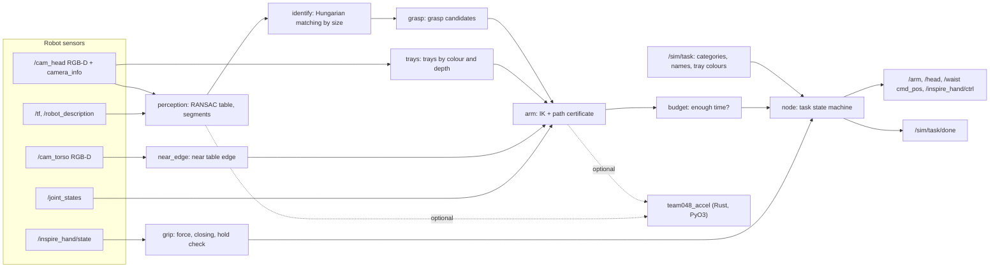

<p align="center">
  
  &nbsp;
  
  &nbsp;
  
  &nbsp;
  
  &nbsp;
  
</p>

[Русский](README.md) | English

# DeftSort — team 048 solution

ROS Humanoid Hack, manipulation track. A TienKung 2.0 Pro humanoid with Inspire hands stands at a table in Isaac Sim 5.0 / Isaac Lab 2.2. It sorts the objects into the coloured trays of their categories: tasks `sort2` (270 s limit) and `sort3` (405 s), in simulation time.

DeftSort is a single Python ROS 2 node. In one layout it:

- finds the table and the trays with the robot's cameras;
- segments the objects and matches them to the `/sim/task` objects;
- plans grasp and placement with a collision check of the whole path;
- decides before lifting whether the object can still be delivered within the limit.

There are no neural networks: only geometry, RANSAC, the Hungarian algorithm, DLS IK and a sphere model of the robot. The numerical kernels are duplicated in an optional Rust module, `team048_accel`. Without it the solution runs its NumPy reference, which gives the same answers.

## Quick start

Requires ROS 2 Humble, Python 3.10 and the organisers' `bodyctrl_msgs` message package.

```bash
pip install -r requirements.txt     # scipy==1.13.1
bash setup.sh                       # once: Rust module from vendor/ (SHA256); NumPy without it; never fails
colcon build                        # rust/ and vendor/ carry COLCON_IGNORE
source install/setup.bash
bash run.sh                         # one layout: waits for /sim/task, sorts, publishes /sim/task/done
```

Tests (no ROS needed; the node runs on stubs with real simulator frames):

```bash
python3 -m pytest -q                      # with the Rust module if installed
TEAM048_ACCEL=0 python3 -m pytest -q      # NumPy reference only
```

`setup.sh` installs the module for `/usr/bin/python3`, the ROS 2 Humble interpreter. In a virtualenv or with another Python, run `TEAM048_PY=$(which python3) bash setup.sh`. `scipy==1.13.1` needs NumPy ≥ 1.22.4, so pip upgrades an older NumPy.

The `pip`, `setup.sh`, `colcon build` and `pytest` steps were run in clean copies of the submission tree (Python 3.10.22, scipy 1.13.1, NumPy 1.26.4 and 2.2.6). `run.sh` needs ROS 2 and a running simulator.

| Variable | Default | Purpose |
|---|---|---|
| `TEAM048_HAND_FORCE` | 0.4 | Finger squeeze force, clamped to 0.3–0.5 (#648) |
| `TEAM048_HAND_SPEED` | 0.5 | Finger speed |
| `TEAM048_CLOSE_PAST` | 0.15 | How far past the measured contact to close, fraction of the stroke |
| `TEAM048_ACCEL` | 1 | `0` disables the Rust module |
| `TEAM048_ACCEL_PARALLEL` | 0 | `1` enables rayon threads |
| `TEAM048_TRACE_DIR` | — | Debugging only: JSON trace and RGB-D frames per object |

## Status

- All offline tests pass. In Rust mode 237 tests pass; 16 of them are equivalence tests that need recorded frames (see [Tests](#tests)). With `TEAM048_ACCEL=0`, 213 pass and 24 are skipped.
- Scoring in the simulator is unstable: the best runs scored 10 points, i.e. one object in a tray. The run history is [below](#simulator-runs).
- The last simulator run predates the current version. Every change since then was checked on CPU only: replay of recorded frames and logs, regression and stress tests. There are no scoring results for the current version.
- Test tubes are not handled: for those tasks the node publishes `/sim/task/done` immediately (0 points, allowed by the rules).

## Architecture



One layout runs like this:

1. Start. The hands receive their force and speed settings.
2. Wait for `/sim/task` and `/clock`.
3. Head survey of the table and trays (yaw 0, ±0.6 rad) before the first arm motion.
4. Path home, certified against the measured scene.
5. Loop over the objects. For each one:
   - observation;
   - identification;
   - grasp candidates;
   - plan and budget check;
   - guarded approach;
   - two-phase close;
   - "empty?" check before lifting;
   - transport and release.
6. Arms home, torso to 0, `/sim/task/done`.

Details: [docs/ARCHITECTURE.md](docs/ARCHITECTURE.md) (Russian).

| Module (`src/team048_solution/team048_solution/`) | Lines | Responsibility |
|---|---:|---|
| `node.py` | 952 | ROS node, task state machine, scene survey, execution, recovery after errors, TRACE |
| `arm.py` | 594 | URDF, collision envelopes (arm, torso, head, other arm, thighs, table, trays), open-hand cloud, grasp and place planning |
| `perception.py` | 297 | Deprojection, RANSAC table plane, near edge, depth-connectivity segmentation |
| `planning.py` | 285 | Spheres, `CollisionModel`: `valid`, `certify`, `certify_escape` |
| `grip.py` | 272 | Hand force and speed, two-phase close, guarded approach, hold rule |
| `kinematics.py` | 239 | URDF chain, FK, Jacobian, DLS IK with null space |
| `trays.py` | 191 | Trays by colour and depth: centre, axis, size, wall height; slots inside |
| `_accel.py` | 167 | Rust ↔ NumPy switch with automatic fallback |
| `grasp.py` | 138 | Grasp candidates: side, rim of open dishes, top |
| `budget.py`, `geometry.py`, `sensing.py` | 89 / 80 / 51 | Time limit, geometry, RGB-D pairs by stamp |

## Rule compliance

| Rule | How | Checked by |
|---|---|---|
| Robot sensors only, no simulator poses (#595.1) | Subscriptions only to sensors and `/sim/task`; debug topics never opened | `test_compliance.py`, `test_node_stub.py`, `test_rules_edges.py` (AST of all subscriptions, publishers and imports) |
| No scene coordinates (#645) | Table, near edge and trays are measured; the code has only search windows, documented sizes and robot geometry | `test_compliance.py` (layout literals by AST), `test_arm.py` (no plan before measurement) |
| Self-collision (#623/#625/#628) | Whole-path certificate, mesh torso, other arm at its measured posture, certified path home | `test_arm.py`, `test_start_posture.py` |
| Hand force 0.3–0.5 (#648) | 0.4 on the squeezing fingers of both hands, request re-sent until answered (at most 5 sends); an arm whose force request was never sent (service not found) is not used; two-phase close | `test_compliance.py`, `test_hand_settings.py`, `test_rules_edges.py` |
| −10 for an object outside its tray or in hand (#595.2) | Time checks before starting and before lifting, with a worst case; on an error the hands open and the arms go home | `test_compliance.py`, `test_place_time.py`, `test_run_robustness.py`, `test_topics_motion.py` |
| Sim-time limit including launch (#595.3, #638) | `use_sim_time`; the age of the `run.sh` process is subtracted pessimistically | `test_compliance.py`, `test_core.py` |
| Each layout in a new process (#636/#638) | State only in process memory | `test_node_stub.py` |
| `camera_info` and `/tf` (#554/#613) | K only from `camera_info`, camera pose from `/tf` at the frame stamp | `test_node_stub.py`, `test_math.py` |
| No heavy models | No neural networks, no GPU; `requirements.txt`: `scipy==1.13.1` only | — |

Details (Russian):

- [docs/COMPLIANCE.md](docs/COMPLIANCE.md) — scene-constant audit, model gaps and the thumb-rotation assumption;
- [docs/ORG_ANSWERS.md](docs/ORG_ANSWERS.md) — organiser answer → code → test matrix.

## Known limitations

| Area | State |
|---|---|
| Simulator check | The current version has not run in the simulator (see [Status](#status)) |
| Heavy objects (≥ 0.22 kg) | None reached a tray in any run: 0 of 5 closes, Utana not counted. They are queued last. At force 0.4 (≈ 3.9 N per finger per INTERFACES) holding needs μ ≥ m·g/(2N); the simulator friction is not in the data |
| Heavy dishes | A rim pinch is allowed only for a gravity torque m·g·r ≤ 0.17 N·m. Utana (0.21–0.22 N·m) is no longer picked: 0 of 7 pinches |
| Thumb rotation | Force 1.0 on DOF 6 (rotation into opposition), 0.4 on the squeezing DOF 1–5. This is our reading of #648, see [docs/COMPLIANCE.md](docs/COMPLIANCE.md#4-захват-648-2026-11-06) |
| Collision model | The held object and objects already placed are not in the model. The commanded path is checked; the real PD-controller path falls short at the shoulder by up to 15 % |
| Torso model | Conservative: on 100 `sort3` pool-3 layouts 7.33 objects per layout are reachable vs 8.31 without the torso |
| Pool 6 | The Razer mouse (10.0 cm) and the gelatin box (8.9 cm) are wider than the pinch opening (7.8 cm), so there are no candidates |
| Test tubes | Not handled, immediate `/sim/task/done` |

## Simulator runs

Runs v6–v11b are our runs of the organisers' simulator on a cloud T4 GPU (RTF ≈ 0.21). The earlier run v5 checked the interfaces; its frames and logs are used in the tests as well. Their logs and frames became test fixtures (`test/fixtures/`), and the constants in the code cite the run they come from.

| Run | Result | What we learned and fixed |
|---|---|---|
| v6, `sort3` × 3 seeds | +10 on one seed | The first observation was taken before the head stopped; the right tray had no release pose |
| v7, `sort3` | +10 on one seed | The table is tilted 4° in the pelvis frame; the thumb was missing from the collision model, side grasps pressed into the table |
| v8, `sort3` seed 103 | 10 (Perricone) | 4 of 5 approaches touched the object; Utana and the mustard slipped on lift (force 1.0) |
| v9a, `sort3` seed 103, self-collision on | 0 | The path home ran before the table was measured and went through the edge (\|F\| up to 938 N); the torso was not modelled |
| v9b, `sort2` seed 101 | 10 (Perricone) | Force reached the right hand only; Threshold is closed on top, all 4 rim pinches hit it with the thumb |
| v11b, `sort2` seed 101 | 0 in trays | Force 0.4 on both hands, Threshold skipped. Perricone slipped on lift, Utana fell during transport. The simulator did not answer the check, so there is no exact score |

One more launch (a second v9a) did not start: the rig received no `/sim/task` within 1512 s.

## Rust acceleration

The crate `rust/team048_accel` 0.2.0 (PyO3 abi3-py310, nalgebra, rayon) duplicates:

- kinematics: FK, Jacobian and DLS IK;
- collisions: sphere checks and `certify`;
- perception: deprojection, RANSAC table, masks, trays and segmentation;
- grasping: caliper and finger clearances.

| Measurement | NumPy | Rust | Speed-up |
|---|---:|---:|---:|
| Perception, ms per frame | 146.7 | 47.9 | 3.1× |
| Planning 10 objects, s | 0.672 | 0.374 | 1.8× |

- **Equivalence.** On 62 recorded frames (Python 3.10, NumPy 1.26), deprojection, plane, trays, masks and segments are bit-identical. Grasp and place poses differ by at most 2.3e-14. There are no discrete differences (object, grasp type, tray, slot, collision verdicts) in any of the 5358 records. Tests: `test_accel_equivalence.py`, `test_accel_kernels.py`.
- **Fallback.** If the module is missing, too old or raises, the solution switches to NumPy for the rest of the process. With `panic = "unwind"`, a Rust panic becomes a Python exception.
- **Delivery.** `vendor/` holds a manylinux2014 x86_64 wheel (abi3, CPython ≥ 3.10) with its SHA256. If the wheel does not install, `setup.sh` builds the module from source with rustup and maturin.
- **Rust checks:** `cd rust/team048_accel && cargo test --release` (18 tests, including proptest) and `cargo clippy --all-targets --features python`, no warnings, rustc 1.89.

## Tests

| File | Tests | What it checks |
|---|---:|---|
| `test_core.py` | 40 | Budget and launch accounting, finger verdict, trays on a real frame, RGB-D pairs, IK null space, head FK vs `/tf`, grasp candidates |
| `test_grip_rules.py` | 19 | Hold rule, guarded approach, jammed fingers (TRACE of runs v7 and v8) |
| `test_topics_motion.py` | 19 | Bounded wait for `/joint_states`, frame freshness, missing joint, atomic hand history, stable tray-component order, motion methods on a fake robot, no dead code |
| `test_compliance.py` | 18 | Topics, no scene constants (AST), #648, −10 policy, time limit |
| `test_accel_kernels.py` | 15 | Rust ↔ NumPy equivalence of the perception and grasp kernels |
| `test_math.py` | 14 | Formula properties: TF vs simulator `/tf` and URDF, pinhole vs `camera_info`, RANSAC, tray rectangle, caliper, Kåsa, rim torque, SO(3), IK, `certify` lever bound |
| `test_rules_edges.py` | 14 | Force range under any override, AST check of interfaces and imports, `done` on a setup error, `bgr8`, tray-axis sign, empty depth frame |
| `test_start_posture.py` | 13 | Start from the v9a posture, `certify_escape`, table model, torso |
| `test_node_stub.py` | 12 | Node wiring and observation on a real frame |
| `test_hand_settings.py` | 10 | Force and speed delivery to both hands, closed top of Threshold |
| `test_hand_clearance.py` | 10 | Open-hand cloud, grasp-centre shift |
| `test_yaw_release.py` | 10 | Empty hand, release, placement with torso yaw |
| `test_run_robustness.py` | 9 | RGB-D pairs under parallel callbacks, exceptions in the task loop, observation retry |
| `test_rim_torque.py` | 8 | Rim torque gate, dish placed by its centre |
| `test_arm.py` | 8 | URDF limits, FK/IK, self-collision, no plan before scene measurement |
| `test_accel_equivalence.py` | 8 | FK, IK, collision, RANSAC equivalence |
| `test_hold_time.py` | 5 | Upper bound of the holding time vs TRACE and timeouts |
| `test_place_time.py` | 5 | `place_time` vs TRACE, light-first order, masses |
| **Total** | **237** | |

The 16 equivalence tests (in `test_accel_kernels.py` and `test_accel_equivalence.py`) run on recorded frames of run v7. Those frames are not part of the submission tree. Point `TEAM048_V7_TRACE` at their directory to run these tests; without it they are skipped. In the submission tree that gives:

- Rust: 221 passed, 16 skipped;
- `TEAM048_ACCEL=0`: 213 passed, 24 skipped.

## Repository layout

```text
.
├── run.sh, setup.sh, requirements.txt     # submission entry points
├── src/team048_solution/                  # ROS 2 package (ament_python)
│   ├── team048_solution/                  # node code
│   │   └── data/                          # URDF, torso spheres, hand geometry, object sizes and masses
│   └── test/                              # pytest + fixtures from the runs (frames, TRACE, logs)
├── rust/team048_accel/                    # Rust crate: src/{kin,col,perc,grasp,rng,py}.rs, benchmarks, proptest
├── vendor/                                # prebuilt team048_accel wheel + SHA256SUMS
├── tools/                                 # offline: sphere fitting to STL meshes, hand geometry
└── docs/                                  # documentation, see below
```

## Documentation (Russian)

| Document | Contents |
|---|---|
| [docs/ARCHITECTURE.md](docs/ARCHITECTURE.md) | Layout life cycle, modules, principles |
| [docs/COMPLIANCE.md](docs/COMPLIANCE.md) | Rules and organiser answers, scene-constant audit, model gaps |
| [docs/ORG_ANSWERS.md](docs/ORG_ANSWERS.md) | Organiser answer → code (file:line) → test matrix |
| [docs/MATH_PHYSICS.md](docs/MATH_PHYSICS.md) | Formulas with code references: frames, deprojection, grasping, IK, collisions, time |
| [docs/PARAMETERS.md](docs/PARAMETERS.md) | Every parameter, its value and origin |
| [docs/PREPUSH_CHECKLIST.md](docs/PREPUSH_CHECKLIST.md) | Checks before submission |
| [CHANGELOG.md](CHANGELOG.md) | Changes to the solution by topic (English) |

## Licences and provenance

- Team code is licensed under Apache-2.0, see [LICENSE](LICENSE). The licence is also declared in `package.xml`, `setup.py` and `Cargo.toml`.
- `data/tiangong_pro_with_hands.urdf` comes from the simulator repository (Apache-2.0, UBTECH) and is used only as the robot's kinematic model.
- The torso and thumb spheres were fitted offline (`tools/fit_spheres.py`, `tools/hand_from_meshes.py`) to the UBTECH-Robot/tiangong2pro_tf STL meshes (Apache-2.0).
- No third-party code was copied.
