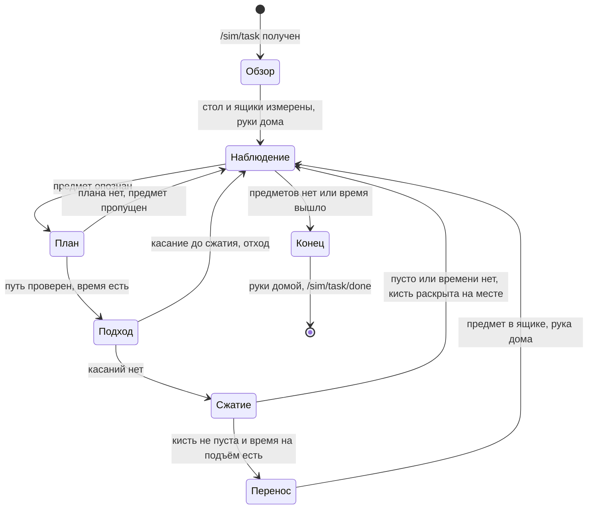

<p align="center">
  
  &nbsp;
  
  &nbsp;
  
  &nbsp;
  
  &nbsp;
  
  &nbsp;
  
</p>

Русский | [English](README.en.md)

# DeftSort

Гуманоид TienKung 2.0 Pro с кистями Inspire стоит у стола. Предметы надо разложить по ящикам своих категорий за 270 секунд (`sort2`) или 405 секунд (`sort3`) по часам симуляции. Где стоит стол, где ящики и что лежит на столе, робот узнаёт только своими камерами.

**Задача.** ROS Humanoid Hack, трек манипуляции: Isaac Sim 5.0 / Isaac Lab 2.2, команда 048.

**Что делает DeftSort.** Один ROS 2-узел на Python. Он измеряет стол и ящики камерами, узнаёт предметы из `/sim/task`, выбирает захват и проверяет на столкновения весь путь руки. Предмет поднимается, только если его успеть донести до конца лимита даже при худшем раскладе.

**Стадия.** Прототип для хакатона. Сборка проверена офлайн: 237 тестов на записанных кадрах и логах наших прогонов в симуляторе организаторов.

## Ключевые преимущества

- **Только датчики робота.** Ни одной координаты сцены в коде: AST-тесты проверяют все подписки, публикации, импорты и литералы раскладки ([test_compliance.py](src/team048_solution/test/test_compliance.py), [test_rules_edges.py](src/team048_solution/test/test_rules_edges.py)).
- **Путь руки проверен целиком.** Сферы руки, торса по мешу, головы и второй руки в её измеренной позе; шаг проверки ≤ 0.003 рад с раздуванием сфер на ход сустава ([planning.py](src/team048_solution/team048_solution/planning.py), [test_start_posture.py](src/team048_solution/test/test_start_posture.py)).
- **Без −10 за предмет в руке.** До подъёма узел считает худшее время удержания, когда каждый шаг уходит в таймаут ([test_hold_time.py](src/team048_solution/test/test_hold_time.py)).
- **Rust-ускоритель с теми же ответами.** На 62 записанных кадрах восприятие совпадает с NumPy бит-в-бит, дискретные решения совпадают во всех 5358 записях ([test_accel_equivalence.py](src/team048_solution/test/test_accel_equivalence.py), [test_accel_kernels.py](src/team048_solution/test/test_accel_kernels.py)).
- **Сила в рамках правил.** 0.4 на сжимающие пальцы обеих кистей, любое переопределение обрезается до 0.3–0.5 ([test_hand_settings.py](src/team048_solution/test/test_hand_settings.py), [docs/COMPLIANCE.md](docs/COMPLIANCE.md#захват-648)).
- **237 офлайн-тестов без ROS.** Узел работает на заглушках с реальными кадрами симулятора; проверка одной командой: `bash tools/verify.sh`.

## Что уже работает

- **Восприятие.** RANSAC-стол, ближний край по торсовой камере, ящики по цвету и глубине с измеренным размером, осью и высотой стенок. Предметы опознаются по размерам венгерским алгоритмом.
- **Захват.** Три вида: сбоку, сверху и щипок за бортик открытой посуды. Центр захвата сдвигается так, чтобы раскрытая кисть не задела предмет по пути.
- **Кисть.** Двухфазное сжатие: до контакта, затем на 0.15 хода дальше. До подъёма узел проверяет, что кисть не пуста.
- **Время.** Бюджет по `/clock` с учётом времени запуска; лёгкие предметы первыми.
- **Устойчивость.** Ошибка в одном предмете раскрывает кисти и возвращает руки домой, прогон продолжается. `/sim/task/done` публикуется всегда.

## Запуск

Нужны ROS 2 Humble, Python 3.10 и пакет сообщений `bodyctrl_msgs` из симулятора организаторов. Из корня клона:

```bash
pip install -r requirements.txt     # scipy==1.13.1
bash setup.sh                       # один раз: Rust-модуль из vendor/ (SHA256); без него работает NumPy
colcon build                        # каталоги rust/ и vendor/ помечены COLCON_IGNORE
source install/setup.bash
bash run.sh                         # одна раскладка: ждёт /sim/task, раскладывает, публикует /sim/task/done
```

Проверка без ROS и симулятора:

```bash
bash tools/verify.sh                      # тесты в обоих режимах, итог одной строкой на режим
python3 -m pytest -q                      # с Rust-модулем, если он установлен
TEAM048_ACCEL=0 python3 -m pytest -q      # только NumPy
```

В чистом клоне: с Rust 221 passed, 16 skipped; с `TEAM048_ACCEL=0` 213 passed, 24 skipped. Пропущены тесты эквивалентности на записанных кадрах прогона v7: эти кадры в репозиторий не входят, каталог задаётся переменной `TEAM048_V7_TRACE`. С ними проходят все 237.

`setup.sh` ставит модуль для `/usr/bin/python3`, интерпретатора ROS 2 Humble. Для virtualenv: `TEAM048_PY=$(which python3) bash setup.sh`. `scipy==1.13.1` требует NumPy ≥ 1.22.4.

| Переменная | По умолчанию | Назначение |
|---|---|---|
| `TEAM048_HAND_FORCE` | 0.4 | Сила сжатия пальцев, обрезается до 0.3–0.5 (#648) |
| `TEAM048_HAND_SPEED` | 0.5 | Скорость пальцев |
| `TEAM048_CLOSE_PAST` | 0.15 | Насколько сжимать «за» измеренный контакт, доля хода |
| `TEAM048_ACCEL` | 1 | `0` отключает Rust-модуль |
| `TEAM048_ACCEL_PARALLEL` | 0 | `1` включает потоки rayon |
| `TEAM048_TRACE_DIR` | — | Для отладки: JSON-трасса и кадры RGB-D по каждому предмету |

## Как устроено


Цикл одного предмета:



Робот сначала смотрит головой на стол и ящики (yaw 0 и ±0.6 рад) и только потом двигает руками. Домой руки идут по пути, проверенному на столкновения с уже измеренной сценой. Дальше предметы по одному: робот смотрит, узнаёт предмет, выбирает захват и считает время. Подходит, следя за касанием, сжимает в две фазы, до подъёма проверяет, что кисть не пуста, несёт и раскрывает. Подробно: [docs/ARCHITECTURE.md](docs/ARCHITECTURE.md).

| Модуль (`src/team048_solution/team048_solution/`) | Строк | Что делает |
|---|---:|---|
| `node.py` | 952 | ROS-узел, автомат задачи, обзор сцены, исполнение, восстановление после ошибок, TRACE |
| `arm.py` | 594 | URDF, оболочки столкновений (рука, торс, голова, другая рука, бёдра, стол, ящики), облако раскрытой кисти, план захвата и укладки |
| `perception.py` | 297 | Депроекция, RANSAC-плоскость стола, ближний край, сегментация по связности глубины |
| `planning.py` | 285 | Сферы, `CollisionModel`: `valid`, `certify`, `certify_escape` |
| `grip.py` | 272 | Сила и скорость кисти, двухфазное сжатие, контроль касания при подходе, правило удержания |
| `kinematics.py` | 239 | Цепь из URDF, FK, якобиан, DLS-ИК с нуль-пространством |
| `trays.py` | 189 | Ящики по цвету и глубине: центр, ось, размер, высота стенок; слоты внутри |
| `_accel.py` | 167 | Переключатель Rust ↔ NumPy с автоматическим откатом |
| `grasp.py` | 138 | Кандидаты захвата: сбоку, за бортик открытой посуды, сверху |
| `budget.py`, `geometry.py`, `sensing.py` | 89 / 80 / 51 | Лимит времени, геометрия, пары RGB-D по метке времени |

### Rust-ускоритель

Крейт `rust/team048_accel` 0.2.0 (PyO3 abi3-py310, nalgebra, rayon) повторяет числовые ядра: FK, якобиан и DLS-ИК; проверку сферами и `certify`; депроекцию, RANSAC стола, маски, ящики и сегментацию; калипер и зазоры пальцев.

- **Те же ответы.** На 62 записанных кадрах депроекция, плоскость, ящики, маски и сегменты совпадают с NumPy бит-в-бит. Позы захвата и укладки расходятся не больше чем на 2.3e-14. Выбор предмета, захвата, ящика, слота и вердикты столкновений совпадают во всех 5358 записях.
- **Откат.** Нет модуля, старая версия или ошибка внутри: процесс до конца работает на NumPy. `panic = "unwind"`, паника в Rust становится исключением Python.
- **Готовая сборка.** В `vendor/` лежит wheel manylinux2014 x86_64 (abi3, CPython ≥ 3.10) с SHA256. Если wheel не встал, `setup.sh` собирает модуль из исходников.
- **Проверки Rust.** `cargo test --release` (18 тестов, включая proptest) и `cargo clippy --all-targets --features python -- -D warnings` без предупреждений, rustc 1.89.

SPEED_TABLE_PLACEHOLDER

### Записанные прогоны

Пороги кисти, времени и восприятия откалиброваны по нашим прогонам симулятора организаторов на GPU NVIDIA T4 (RTF ≈ 0.21). Метки v5–v11b — номера этих прогонов, а не версии кода. Их кадры, TRACE и строки логов лежат в `test/fixtures/`, а константы в коде ссылаются на прогон-источник ([docs/PARAMETERS.md](docs/PARAMETERS.md)).

## Откуда взяты решения

| Приём | Источник | Где в коде |
|---|---|---|
| Плоскость стола RANSAC + SVD | Fischler, Bolles, 1981 | `perception.py` |
| Сопоставление сегментов с объектами | Задача о назначениях, Kuhn, 1955; `scipy.optimize.linear_sum_assignment` | `node.py` |
| Ширина отпечатка | Вращающиеся калиперы, Toussaint, 1983 | `grasp.py` |
| Окружность бортика | МНК-окружность Kåsa, 1976 | `grasp.py` |
| ИК с демпфированием и нуль-пространством | DLS: Wampler, 1986; Nakamura, Hanafusa, 1986 | `kinematics.py` |
| Проверка пути | Сферическая модель робота, дискретная проверка с раздуванием сфер на ход сустава | `planning.py` |
| Двухфазное сжатие, большой палец первым | Совет организаторов #648 | `grip.py`, `node.py` |

Геометрия робота — URDF и меши UBTECH (Apache-2.0). Нейросетей нет.

## Границы

| Область | Сейчас | Следующий шаг |
|---|---|---|
| Проверка в Isaac Sim | Офлайн: 237 тестов, записанные кадры и логи прогонов v5–v11b | Прогон текущей сборки в Isaac Sim, `sort2` и `sort3` |
| Тяжёлые предметы (≥ 0.22 кг) | Идут в конце очереди; удержание при силе 0.4 требует μ ≥ m·g/(2N) | Калибровка трения симулятора по TRACE |
| Посуда за бортик | Щипок при моменте m·g·r ≤ 0.17 Н·м | Захват тяжёлой посуды двумя точками |
| Поворот большого пальца | DOF 6 = 1.0: ставит палец в оппозицию, предмет не сжимает ([COMPLIANCE](docs/COMPLIANCE.md#захват-648)) | Одна константа `grip.HAND_FORCE_THUMB_ROT`, если организаторы попросят 0.3–0.5 и для неё |
| Модель столкновений | Рука, торс, голова, вторая рука, бёдра, стол, ящики | Предмет в кисти и уже уложенные предметы |
| Пул 6 | Мышь Razer (10.0 см) и желатин (8.9 см) шире раскрытого щипка (7.8 см) | Захват сверху широкой кистью |
| Пробирки | Вне объёма этой версии: узел сразу публикует `/sim/task/done` | Штативы и шкаф тоже искать камерами |

## Трудные вопросы

| Вопрос | Ответ |
|---|---|
| Почему поворот большого пальца на силе 1.0, если правило говорит 0.3–0.5? | Совет #648 про силу сжатия предмета. Сжимают DOF 1–5, и они на 0.4. DOF 6 только разворачивает палец в оппозицию до сжатия. По логам HAND усилие этого канала доходит до 1.0, поэтому 0.5 данными не подтверждено. |
| Откуда робот знает, где ящики? | Измеряет: цвет из `/sim/task`, глубина, прямоугольник минимальной площади. В коде только широкие окна «слева», «справа», «по центру» и размер из описания сцены как граница правдоподобия ±40 %. |
| Что будет, если время кончается с предметом в руке? | Такого не будет. Подъём разрешён, только если остаток покрывает худшее время удержания, когда каждый шаг уходит в таймаут. Иначе кисть раскрывается на месте: 0 вместо −10. |
| Зачем Rust, если есть NumPy? | Восприятие и планирование быстрее, ответы те же: это проверяют тесты эквивалентности на 62 кадрах. Без модуля решение работает целиком на NumPy. |
| Почему нет нейросетей? | Объектов мало, размеры известны из задания. Геометрия детерминирована, проверяется тестами и не требует GPU. |

## Документы

| Документ | Что внутри |
|---|---|
| [docs/ARCHITECTURE.md](docs/ARCHITECTURE.md) | Жизненный цикл раскладки, модули, принципы |
| [docs/COMPLIANCE.md](docs/COMPLIANCE.md) | Правила и ответы организаторов: где это в коде и чем проверено |
| [docs/MATH_PHYSICS.md](docs/MATH_PHYSICS.md) | Формулы со ссылками на код: системы координат, депроекция, захват, ИК, столкновения, время |
| [docs/PARAMETERS.md](docs/PARAMETERS.md) | Каждый параметр, его значение и откуда оно взято |
| [CHANGELOG.md](CHANGELOG.md) | Возможности решения по темам |

## Лицензия

Apache-2.0, текст в [LICENSE](LICENSE). `data/tiangong_pro_with_hands.urdf` взят из репозитория симулятора (Apache-2.0, UBTECH) и служит только кинематической моделью робота. Сферы торса и большого пальца подогнаны офлайн (`tools/fit_spheres.py`, `tools/hand_from_meshes.py`) по STL-мешам UBTECH-Robot/tiangong2pro_tf (Apache-2.0). Остальной код написан командой.
