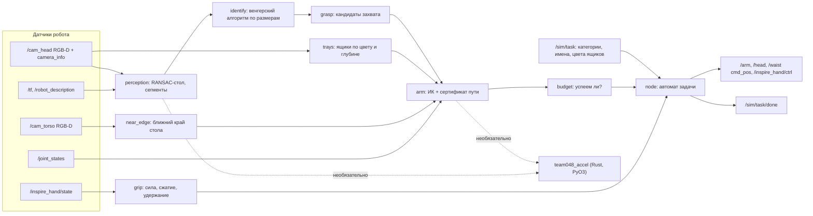

<p align="center">
  
  &nbsp;
  
  &nbsp;
  
  &nbsp;
  
  &nbsp;
  
</p>

Русский | [English](README.en.md)

# DeftSort — решение команды 048

ROS Humanoid Hack, трек манипуляции. Гуманоид TienKung 2.0 Pro с кистями Inspire стоит у стола в Isaac Sim 5.0 / Isaac Lab 2.2 и раскладывает предметы по цветным ящикам их категорий: задачи `sort2` (лимит 270 с) и `sort3` (405 с) по часам симуляции.

DeftSort — один ROS 2-узел на Python. За одну раскладку он:

- находит стол и ящики камерами робота;
- выделяет предметы и сопоставляет их с объектами из `/sim/task`;
- планирует захват и укладку с проверкой столкновений всего пути;
- до подъёма решает, успеет ли донести предмет до конца лимита.

Нейросетей нет: только геометрия, RANSAC, венгерский алгоритм, DLS-ИК и сферическая модель робота. Числовые ядра продублированы в необязательном Rust-модуле `team048_accel`. Если модуля нет, используется эталон на NumPy с теми же ответами.

## Быстрый старт

Нужны ROS 2 Humble, Python 3.10 и пакет сообщений `bodyctrl_msgs` из симулятора организаторов.

```bash
pip install -r requirements.txt     # scipy==1.13.1
bash setup.sh                       # один раз: Rust-модуль из vendor/ (SHA256), без него — NumPy; ошибкой не завершается
colcon build                        # каталоги rust/ и vendor/ помечены COLCON_IGNORE
source install/setup.bash
bash run.sh                         # одна раскладка: ждёт /sim/task, раскладывает, публикует /sim/task/done
```

Тесты (ROS не нужен, узел проверяется на заглушках с реальными кадрами симулятора):

```bash
python3 -m pytest -q                      # с Rust-модулем, если он установлен
TEAM048_ACCEL=0 python3 -m pytest -q      # только NumPy-эталон
```

Шаги `pip`, `setup.sh`, `colcon build` и `pytest` проверены в чистой копии дерева сдачи (Python 3.10.22, NumPy 1.26.4, scipy 1.13.1). `run.sh` требует ROS 2 и запущенный симулятор.

| Переменная | По умолчанию | Назначение |
|---|---|---|
| `TEAM048_HAND_FORCE` | 0.4 | Сила сжатия пальцев, обрезается до 0.3–0.5 (#648) |
| `TEAM048_HAND_SPEED` | 0.5 | Скорость пальцев |
| `TEAM048_CLOSE_PAST` | 0.15 | Насколько сжимать «за» измеренный контакт, доля хода |
| `TEAM048_ACCEL` | 1 | `0` отключает Rust-модуль |
| `TEAM048_ACCEL_PARALLEL` | 0 | `1` включает потоки rayon |
| `TEAM048_TRACE_DIR` | — | Только для отладки: JSON-трасса и кадры RGB-D по каждому объекту |

## Статус

- Офлайн все тесты проходят. В режиме Rust проходят 237 тестов, из них 16 тестов эквивалентности требуют записанных кадров (см. [Тесты](#тесты)). С `TEAM048_ACCEL=0` проходят 213, 24 пропущены.
- В симуляторе решение набирает очки нестабильно: в лучших прогонах 10 очков, то есть один предмет в ящике. История прогонов приведена [ниже](#проверка-в-симуляторе).
- Последний прогон в симуляторе был до текущей версии. Все последующие изменения проверены только на CPU: реплей записанных кадров и логов, регрессионные и стресс-тесты. Результатов скоринга для текущей версии нет.
- Пробирки не решаются: для этих задач узел сразу публикует `/sim/task/done` (0 очков, правилами допускается).

## Архитектура



Одна раскладка проходит так:

1. Старт. Кисти получают силу и скорость.
2. Ожидание `/sim/task` и `/clock`.
3. Обзор стола и ящиков головой (yaw 0, ±0.6 рад) до первого движения рук.
4. Путь домой, сертифицированный против измеренной сцены.
5. Цикл по предметам. Для каждого:
   - наблюдение;
   - опознание;
   - кандидаты захвата;
   - план и бюджет;
   - подход с охраной;
   - двухфазное сжатие;
   - проверка «пусто?» до подъёма;
   - перенос и раскрытие.
6. Руки домой, корпус в 0, `/sim/task/done`.

Подробно: [docs/ARCHITECTURE.md](docs/ARCHITECTURE.md).

| Модуль (`src/team048_solution/team048_solution/`) | Строк | Ответственность |
|---|---:|---|
| `node.py` | 952 | ROS-узел, автомат задачи, обзор сцены, исполнение, восстановление после ошибок, TRACE |
| `arm.py` | 594 | URDF, оболочки столкновений (рука, торс, голова, другая рука, бёдра, стол, ящики), облако раскрытой кисти, планирование захвата и укладки |
| `perception.py` | 297 | Депроекция, RANSAC-плоскость стола, ближний край, сегментация по связности глубины |
| `planning.py` | 285 | Сферы, `CollisionModel`: `valid`, `certify`, `certify_escape` |
| `grip.py` | 272 | Сила и скорость кисти, двухфазное сжатие, охрана подхода, правило удержания |
| `kinematics.py` | 239 | Цепь из URDF, FK, якобиан, DLS-ИК с нуль-пространством |
| `trays.py` | 191 | Ящики по цвету и глубине: центр, ось, размер, высота стенок; места внутри |
| `_accel.py` | 167 | Переключатель Rust ↔ NumPy с автоматическим откатом |
| `grasp.py` | 138 | Кандидаты захвата: сбоку, за бортик открытой посуды, сверху |
| `budget.py`, `geometry.py`, `sensing.py` | 89 / 80 / 51 | Лимит времени, геометрия, пары RGB-D по метке времени |

## Соответствие правилам

| Правило | Как выполнено | Чем проверено |
|---|---|---|
| Только датчики робота, без поз из симулятора (#595.1) | Подписки только на датчики и `/sim/task`; отладочные топики не открываются | `test_compliance.py`, `test_node_stub.py`, `test_rules_edges.py` (AST всех подписок, публикаций и импортов) |
| Нет координат сцены (#645) | Стол, ближний край и ящики измеряются; в коде только окна поиска, размеры из документации и геометрия робота | `test_compliance.py` (литералы раскладки по AST), `test_arm.py` (нет плана до измерения) |
| Самопересечения (#623/#625/#628) | Сертификат всего пути, торс по мешу, другая рука в измеренной позе, путь домой тоже сертифицирован | `test_arm.py`, `test_start_posture.py` |
| Сила кисти 0.3–0.5 (#648) | 0.4 на сжимающие пальцы обеих кистей, повтор запроса до ответа; рука без подтверждённой силы не используется; двухфазное сжатие | `test_compliance.py`, `test_hand_settings.py`, `test_rules_edges.py` |
| −10 за предмет вне ящика или в руке (#595.2) | Проверки времени до старта и до подъёма с худшим случаем; при ошибке кисти раскрываются, руки уходят домой | `test_compliance.py`, `test_audit.py`, `test_run_robustness.py`, `test_topics_motion.py` |
| Лимит по времени симуляции, запуск входит (#595.3, #638) | `use_sim_time`, возраст процесса `run.sh` вычитается пессимистично | `test_compliance.py`, `test_ideas.py` |
| Каждая раскладка в новом процессе (#636/#638) | Состояние только в памяти процесса | `test_node_stub.py` |
| `camera_info` и `/tf` (#554/#613) | K только из `camera_info`, поза камеры из `/tf` на метку кадра | `test_node_stub.py`, `test_math.py` |
| Без тяжёлых моделей | Нейросетей и GPU нет; `requirements.txt`: только `scipy==1.13.1` | — |

Подробно:

- [docs/COMPLIANCE.md](docs/COMPLIANCE.md) — аудит констант сцены, известные пробелы модели и принятое допущение о повороте большого пальца;
- [docs/ORG_ANSWERS.md](docs/ORG_ANSWERS.md) — матрица «ответ организатора → код → тест».

## Известные ограничения

| Область | Состояние |
|---|---|
| Проверка в симуляторе | Текущая версия в симуляторе не запускалась (см. [Статус](#статус)) |
| Тяжёлые предметы (≥ 0.22 кг) | Ни одного в ящике за все прогоны: 0 из 5 сжатий, не считая Utana. Такие предметы идут в конце очереди. При силе 0.4 (≈ 3.9 Н на палец по INTERFACES) удержание требует μ ≥ m·g/(2N); трения симулятора в данных нет |
| Тяжёлая посуда | Щипок за бортик разрешён только при моменте m·g·r ≤ 0.17 Н·м. Utana (0.21–0.22 Н·м) больше не берётся: 0 из 7 щипков |
| Поворот большого пальца | Сила 1.0 на DOF 6 (поворот в оппозицию), 0.4 на сжимающие DOF 1–5. Это толкование совета #648, см. [docs/COMPLIANCE.md](docs/COMPLIANCE.md#4-захват-648-2026-11-06) |
| Модель столкновений | Предмет в кисти и уже уложенные предметы в модель не входят. Проверяется командный путь; реальный путь PD-регулятора у плеча недолетает до 15 % |
| Модель торса | Консервативна: на 100 раскладках `sort3` пула 3 достижимо 7.33 объекта на раскладку против 8.31 без торса |
| Пул 6 | Мышь Razer (10.0 см) и коробка желатина (8.9 см) шире раскрытия щипка (7.8 см), кандидатов нет |
| Пробирки | Не решаются, сразу `/sim/task/done` |

## Проверка в симуляторе

Прогоны v6–v11b — наши запуски симулятора организаторов на облачной GPU T4 (RTF ≈ 0.21). Более ранний прогон v5 проверял интерфейсы; его кадры и логи тоже используются в тестах. Логи и кадры из них стали фикстурами тестов (`test/fixtures/`), а константы в коде ссылаются на прогон-источник.

| Прогон | Итог | Что выяснилось и исправлено |
|---|---|---|
| v6, `sort3` × 3 сида | +10 на одном сиде | Первое наблюдение снималось до остановки головы; у правого ящика не было позы отпускания |
| v7, `sort3` | +10 на одном сиде | Стол в системе таза наклонён на 4°; большого пальца не было в модели столкновений, боковые захваты давили в стол |
| v8, `sort3` сид 103 | 10 (Perricone) | 4 из 5 подходов задевали предмет; Utana и горчица выскользнули при подъёме (сила 1.0) |
| v9a, `sort3` сид 103, самопересечения включены | 0 | Путь домой шёл до измерения стола и прошёл сквозь кромку (\|F\| до 938 Н); торса не было в модели |
| v9b, `sort2` сид 101 | 10 (Perricone) | Сила дошла только до правой кисти; Threshold закрыт сверху, щипок за бортик 4 раза из 4 упирался большим пальцем |
| v11b, `sort2` сид 101 | 0 в ящиках | Сила 0.4 на обеих кистях, Threshold пропущен. Perricone соскользнул при подъёме, Utana выпала на переносе. Симулятор не ответил на проверку, точного счёта нет |

Ещё один запуск (v9a, второй) не стартовал: стенд за 1512 с не получил `/sim/task`.

## Ускорение на Rust

Крейт `rust/team048_accel` 0.2.0 (PyO3 abi3-py310, nalgebra, rayon). В нём продублированы:

- кинематика: FK, якобиан и DLS-ИК;
- столкновения: проверка сферами и `certify`;
- восприятие: депроекция, RANSAC стола, маски, ящики и сегментация;
- захват: калипер и зазоры пальцев.

| Замер | NumPy | Rust | Ускорение |
|---|---:|---:|---:|
| Восприятие, мс на кадр | 146.7 | 47.9 | 3.1× |
| Планирование 10 объектов, с | 0.672 | 0.374 | 1.8× |

- **Эквивалентность.** На 62 записанных кадрах (Python 3.10, NumPy 1.26) сравнивались депроекция, плоскость, ящики, маски и сегменты: они совпадают бит-в-бит. Позы захвата и укладки различаются не больше чем на 2.3e-14. Дискретных различий (выбор объекта, типа захвата, ящика, слота, вердикты столкновений) нет ни в одной из 5358 записей. Тесты: `test_accel_equivalence.py`, `test_accel_phase2.py`.
- **Откат.** Если модуля нет, его версия старая или он выдал ошибку, решение до конца процесса работает на NumPy. `panic = "unwind"`, поэтому паника в Rust становится исключением Python.
- **Поставка.** В `vendor/` лежит wheel manylinux2014 x86_64 (abi3, CPython ≥ 3.10) с SHA256. Если wheel не встал, `setup.sh` собирает модуль из исходников через rustup и maturin.
- **Проверки Rust:** `cd rust/team048_accel && cargo test --release` (18 тестов, включая proptest) и `cargo clippy --all-targets --features python` без предупреждений, rustc 1.89.

## Тесты

| Файл | Тестов | Что проверяет |
|---|---:|---|
| `test_ideas.py` | 40 | Бюджет и учёт запуска, вердикт по пальцам, ящики на реальном кадре, пары RGB-D, нуль-пространство ИК, FK головы против `/tf`, кандидаты захвата |
| `test_grip_rules.py` | 19 | Правило удержания, охрана подхода, заклинившие пальцы (TRACE прогонов v7 и v8) |
| `test_topics_motion.py` | 19 | Ожидание `/joint_states` в пределах бюджета, свежесть кадра, пропавший сустав, атомарная история кисти, устойчивый порядок компонент ящика, методы движения на поддельном роботе, отсутствие мёртвого кода |
| `test_compliance.py` | 18 | Топики, отсутствие констант сцены (AST), #648, политика −10, лимит времени |
| `test_accel_phase2.py` | 15 | Эквивалентность Rust ↔ NumPy ядер восприятия и захвата |
| `test_math.py` | 14 | Свойства формул: TF против `/tf` симулятора и URDF, пинхол против `camera_info`, RANSAC, прямоугольник ящика, калипер, Kåsa, момент бортика, SO(3), ИК, оценка рычагов `certify` |
| `test_rules_edges.py` | 14 | Диапазон силы при любом переопределении, AST-проверка интерфейсов и импортов, `done` при ошибке настройки, `bgr8`, знак оси ящика, пустой кадр глубины |
| `test_start_posture.py` | 13 | Старт из позы прогона v9a, `certify_escape`, модель стола, торс |
| `test_node_stub.py` | 12 | Проводка узла и наблюдение на реальном кадре |
| `test_hand_settings.py` | 10 | Доставка силы и скорости обеим кистям, закрытый верх Threshold |
| `test_hand_clearance.py` | 10 | Облако раскрытой кисти, сдвиг центра захвата |
| `test_yaw_release.py` | 10 | Пустая кисть, раскрытие, укладка с поворотом корпуса |
| `test_run_robustness.py` | 9 | Пары RGB-D при параллельных колбэках, исключения в цикле задачи, повтор наблюдения |
| `test_rim_torque.py` | 8 | Порог момента для бортика, укладка посуды центром в слот |
| `test_arm.py` | 8 | Пределы из URDF, FK/ИК, самопересечения, нет плана до измерения сцены |
| `test_accel_equivalence.py` | 8 | Эквивалентность FK, ИК, столкновений, RANSAC |
| `test_hold_time.py` | 5 | Верхняя граница времени удержания против TRACE и таймаутов |
| `test_audit.py` | 5 | `place_time` против TRACE, порядок «сначала лёгкие», массы |
| **Всего** | **237** | |

16 тестов эквивалентности (в `test_accel_phase2.py` и `test_accel_equivalence.py`) работают на записанных кадрах прогона v7. Эти кадры в дерево сдачи не входят: каталог можно указать переменной `TEAM048_V7_TRACE`, без неё тесты пропускаются. В дереве сдачи получается так:

- Rust: 221 passed, 16 skipped;
- `TEAM048_ACCEL=0`: 213 passed, 24 skipped.

## Структура репозитория

```text
.
├── run.sh, setup.sh, requirements.txt     # точки входа формата сдачи
├── src/team048_solution/                  # пакет ROS 2 (ament_python)
│   ├── team048_solution/                  # код узла
│   │   └── data/                          # URDF, сферы торса, геометрия кисти, размеры и массы объектов
│   └── test/                              # pytest + фикстуры из прогонов (кадры, TRACE, логи)
├── rust/team048_accel/                    # Rust-крейт: src/{kin,col,perc,grasp,rng,py}.rs, бенчмарки, proptest
├── vendor/                                # готовый wheel team048_accel + SHA256SUMS
├── tools/                                 # офлайн: подгонка сфер по STL-мешам, геометрия кисти
└── docs/                                  # документация, см. ниже
```

## Документация

| Документ | Содержание |
|---|---|
| [docs/ARCHITECTURE.md](docs/ARCHITECTURE.md) | Жизненный цикл раскладки, модули, принципы |
| [docs/COMPLIANCE.md](docs/COMPLIANCE.md) | Соответствие правилам и ответам организаторов, аудит констант сцены, пробелы модели |
| [docs/ORG_ANSWERS.md](docs/ORG_ANSWERS.md) | Матрица «ответ организатора → код (файл:строка) → тест» |
| [docs/MATH_PHYSICS.md](docs/MATH_PHYSICS.md) | Формулы со ссылками на код: системы координат, депроекция, захват, ИК, столкновения, время |
| [docs/PARAMETERS.md](docs/PARAMETERS.md) | Каждый параметр, его значение и происхождение |
| [docs/PREPUSH_CHECKLIST.md](docs/PREPUSH_CHECKLIST.md) | Проверки перед сдачей |
| [CHANGELOG.md](CHANGELOG.md) | Изменения решения по темам (на английском) |

## Лицензии и происхождение

- Код команды распространяется под Apache-2.0, текст в [LICENSE](LICENSE). Лицензия указана также в `package.xml`, `setup.py` и `Cargo.toml`.
- `data/tiangong_pro_with_hands.urdf` взят из репозитория симулятора (Apache-2.0, UBTECH) и используется только как кинематическая модель робота.
- Сферы торса и большого пальца подогнаны офлайн (`tools/fit_spheres.py`, `tools/hand_from_meshes.py`) по STL-мешам UBTECH-Robot/tiangong2pro_tf (Apache-2.0).
- Чужой код не копировался.
