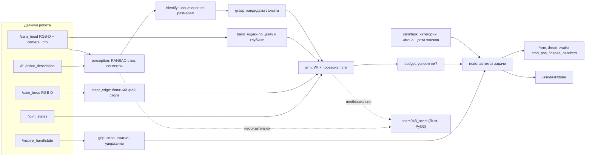
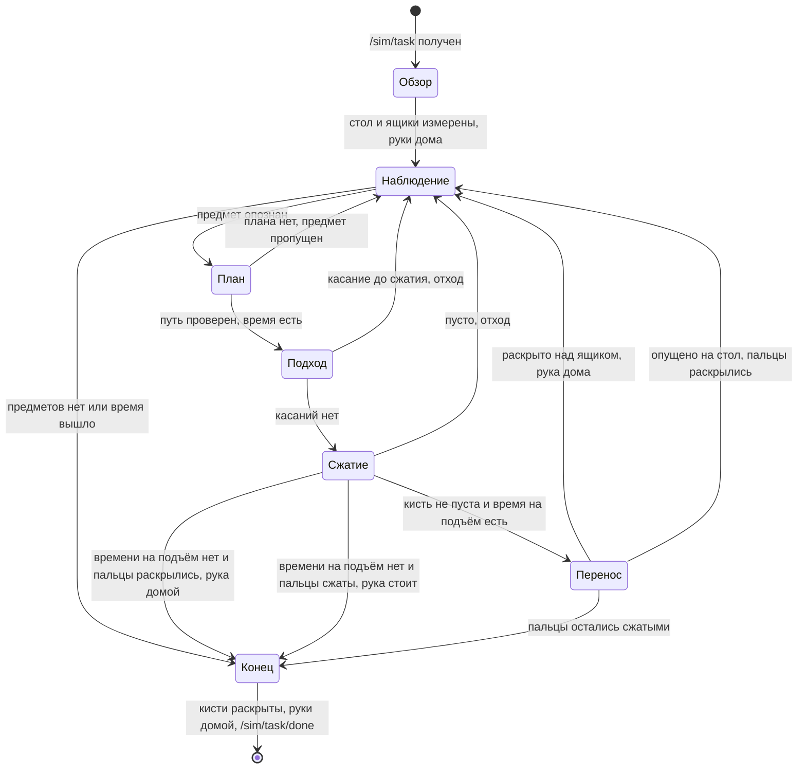
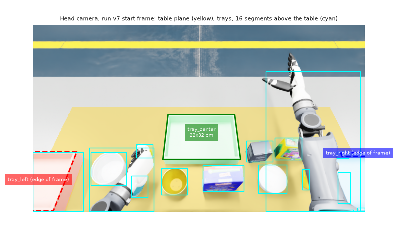
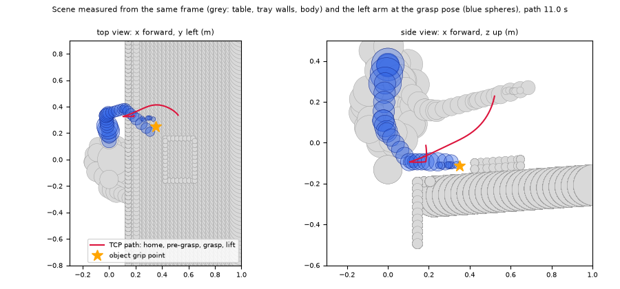

<p align="center">
  
  &nbsp;
  
  &nbsp;
  
  &nbsp;
  
  &nbsp;
  
  &nbsp;
  
</p>

Русский | [English](README.en.md)

# DeftSort

[Преимущества](#ключевые-преимущества) · [Что работает](#что-уже-работает) · [Запуск](#запуск) · [Как устроено](#как-устроено) · [Источники решений](#откуда-взяты-решения) · [Границы](#границы) · [Трудные вопросы](#трудные-вопросы) · [Документы](#документы) · [Лицензия](#лицензия)

Гуманоид TienKung 2.0 Pro с кистями Inspire стоит у стола. Предметы надо разложить по ящикам своих категорий за 270 секунд (`sort2`) или 405 секунд (`sort3`) по часам симуляции. Где стоит стол, где ящики и что лежит на столе, робот узнаёт только своими камерами.

**Задача.** ROS Humanoid Hack, трек манипуляции: Isaac Sim 5.0 / Isaac Lab 2.2, команда 048.

**Что делает DeftSort.** Один ROS 2-узел на Python ведёт каждый предмет по одной цепочке:

1. **Видит.** Стол, ящики и предметы измеряются камерами головы и торса. Координат сцены в коде нет.
2. **Выбирает захват.** Предмет опознаётся по размерам из `/sim/task`, захват сбоку, сверху или за бортик строится по облаку точек.
3. **Проверяет путь.** Путь руки к предмету и к ящику проверяется на столкновения сферической моделью робота и измеренной сцены.
4. **Поднимает с запасом.** Подъём разрешён, если кисть не пуста и остаток лимита покрывает худшее время переноса. Иначе кисть раскрывается. Раскрытые пальцы — рука домой. Раскладка заканчивается, следующий предмет не берётся.

**Почему это приносит очки.** Очки дают предметы в своих ящиках, а поднятый и не донесённый предмет стоит −10. DeftSort поднимает предмет, только когда есть проверенный путь и время его донести. Каждый подъём нацелен на +10, сомнительный случай стоит 0.

**Стадия.** Прототип для хакатона. Сборка проверена офлайн: 293 теста на записанных кадрах и логах наших прогонов в симуляторе организаторов.

## Ключевые преимущества

- **Только датчики робота.** Ни одной координаты сцены в коде: AST-тесты проверяют все подписки, публикации, импорты и литералы раскладки ([test_compliance.py](src/team048_solution/test/test_compliance.py), [test_rules_edges.py](src/team048_solution/test/test_rules_edges.py)).
- **Путь руки проверен целиком.** Сферы руки, торса по мешу, головы и второй руки в её измеренной позе; шаг проверки ≤ 0.003 рад с раздуванием сфер на ход сустава. Пара, свободная в старте, остаётся свободной на всём отрезке, в том числе на пути домой из стартовой позы. Поворот корпуса с предметом проверен на всей дуге, а стол и ящики при повороте остаются в системе таза ([planning.py](src/team048_solution/team048_solution/planning.py), [test_start_posture.py](src/team048_solution/test/test_start_posture.py)).
- **Подъём только с запасом времени.** Предмет поднимается, только если остаток лимита покрывает худшее время удержания: подъём, перенос, поворот корпуса, укладка с коррекцией, повторный подход к ящику с коррекцией и раскрытие, каждый шаг до своего тайм-аута. Иначе кисть раскрывается, предмет остаётся на столе, и раскладка заканчивается. Кисть, которая так и читается сжатой, из этой позы домой не уводится ([test_hold_time.py](src/team048_solution/test/test_hold_time.py), [test_compliance.py](src/team048_solution/test/test_compliance.py)).
- **Rust-ускоритель с теми же ответами.** На 62 кадрах наших прогонов (кадры в репозиторий не входят) восприятие совпадает с NumPy бит-в-бит, дискретные решения совпадают во всех 5358 записях. Восприятие при этом в 15 раз быстрее, планирование захвата в 223 раза ([замер](#rust-ускоритель); [test_accel_equivalence.py](src/team048_solution/test/test_accel_equivalence.py), [test_accel_kernels.py](src/team048_solution/test/test_accel_kernels.py)).
- **Сила в рамках правил.** Все шесть каналов `SetForce` обеих кистей в пределах 0.3–0.5: 0.4 на сжимающие пальцы, 0.5 на поворот большого пальца; любое переопределение обрезается до 0.3–0.5 ([test_rules_edges.py](src/team048_solution/test/test_rules_edges.py), [test_hand_settings.py](src/team048_solution/test/test_hand_settings.py), [docs/COMPLIANCE.md](docs/COMPLIANCE.md#захват-648)).
- **293 офлайн-теста без ROS.** Узел работает на заглушках с реальными кадрами симулятора; проверка одной командой: `bash tools/verify.sh`.

## Что уже работает

- **Восприятие.** RANSAC-стол, ближний край по торсовой камере, ящики по цвету и глубине с измеренным размером, осью и высотой стенок. Предметы опознаются по размерам: сегменты и объекты задания сопоставляются как задача о назначениях. Число выборок RANSAC растёт, когда доля точек стола в кадре мала.
- **Захват.** Три вида: сбоку, сверху и щипок за бортик открытой посуды. Центр захвата сдвигается так, чтобы раскрытая кисть не задела предмет по пути. Захват, который уже исполнялся и не удался, при повторе идёт последним в списке кандидатов.
- **Кисть.** Двухфазное сжатие: до контакта, затем на 0.15 хода дальше. До подъёма узел проверяет, что кисть не пуста.
- **Укладка.** Кисть раскрывается, когда TCP в пределах 4 см от плана или точка укладки внутри измеренного прямоугольника ящика. Иначе один повторный подход. Если точка всё ещё вне ящика, предмет несётся обратно на стол, только когда остаток минус 8 с покрывает худшее время возврата; иначе кисть раскрывается на месте. Перенос засчитывается, только если над ящиком кисть не пуста и пальцы после раскрытия не остались сжатыми. Сжатые пальцы останавливают цикл.
- **Время.** Бюджет по `/clock` с учётом времени запуска; лёгкие предметы первыми.
- **Устойчивость.** Ошибка в одном предмете раскрывает кисти и возвращает руки домой, прогон продолжается. Если после раскрытия пальцы так и читаются сжатыми, прогон останавливается до следующего предмета; в конце кисти раскрываются ещё раз, и только потом руки идут домой. Колбэки ROS отбрасывают битые сообщения с записью в лог, некорректная задача в `/sim/task` пропускается, и узел ждёт следующую. `/sim/task/done` публикуется один раз в конце прогона, в том числе после ошибки настройки и после ошибки вне цикла задачи.

## Запуск

Нужны ROS 2 Humble, Python 3.10 и пакет сообщений `bodyctrl_msgs` из симулятора организаторов. Из корня клона:

```bash
pip install -r requirements.txt     # scipy==1.13.1
bash setup.sh                       # один раз: Rust-модуль из vendor/ (SHA256); без него работает NumPy
colcon build                        # каталоги rust/ и vendor/ помечены COLCON_IGNORE
source install/setup.bash
bash run.sh                         # одна раскладка: ждёт /sim/task, раскладывает, публикует /sim/task/done
```

`run.sh` сам подключает `install/setup.bash`, если каталог `install/` лежит рядом, поэтому запуск не зависит от того, подключено ли окружение в вызывающей оболочке.

Проверка без ROS и симулятора:

```bash
bash tools/verify.sh                      # тесты в обоих режимах, сверка документов, линтер, cargo test: строка на шаг
python3 -m pytest -q                      # с Rust-модулем, если он установлен
TEAM048_ACCEL=0 python3 -m pytest -q      # только NumPy
```

В чистом клоне: с Rust 277 passed, 16 skipped; с `TEAM048_ACCEL=0` 269 passed, 24 skipped. 16 пропусков — тесты эквивалентности на записанных кадрах прогона v7 (этих кадров в репозитории нет, каталог задаётся `TEAM048_V7_TRACE`), ещё 8 — тесты Rust-модуля, они пропускаются при `TEAM048_ACCEL=0`. С кадрами и модулем проходят все 293.

Те же проверки идут в CI ([.github/workflows/ci.yml](.github/workflows/ci.yml)): тесты в обоих режимах на двух наборах версий, линтер (`ruff.toml`), сверка документов с репозиторием (`tools/check_docs.py`), `shellcheck`, `cargo fmt`, `clippy`, `cargo test` и сборка Rust-модуля из исходников.

| Переменная | По умолчанию | Назначение |
|---|---|---|
| `TEAM048_HAND_FORCE` | 0.4 | Сила сжатия пальцев, обрезается до 0.3–0.5 (#648) |
| `TEAM048_HAND_SPEED` | 0.5 | Скорость пальцев |
| `TEAM048_CLOSE_PAST` | 0.15 | Насколько сжимать «за» измеренный контакт, доля хода |
| `TEAM048_ACCEL` | 1 | `0` отключает Rust-модуль |
| `TEAM048_ACCEL_PARALLEL` | 0 | `1` включает потоки rayon |
| `TEAM048_TRACE_DIR` | — | Для отладки: JSON-трасса и кадры RGB-D по каждому предмету |
| `TEAM048_PY` | `/usr/bin/python3` | Интерпретатор, для которого `setup.sh` ставит Rust-модуль |
| `TEAM048_NO_BUILD` | 0 | `1` запрещает `setup.sh` собирать Rust-модуль из исходников |
| `TEAM048_FORCE_BUILD` | 0 | `1` пропускает готовый wheel, `setup.sh` собирает модуль из исходников |
| `TEAM048_ACCEL_NO_AVX2` | — | Любое значение отключает ядра AVX2 в Rust-модуле |
| `TEAM048_V7_TRACE` | — | Каталог записанных кадров прогона v7 для тестов эквивалентности |
| `TEAM048_TORSO_MESH` | 1 | `0` отключает сферы торса по мешу; только для офлайн-сравнений |
| `TEAM048_FRAME_TOOLS` | — | Каталог помощника кадров для `rust/team048_accel/benches/export_model.py` |
| `HACK_URDF` | `data/tiangong_pro_with_hands.urdf` | URDF робота по умолчанию; полный `/robot_description` его заменяет |
| `CARGO_HOME`, `RUSTUP_HOME` | `/opt/team048/cargo`, `/opt/team048/rustup` | Куда `setup.sh` ставит Rust, если собирает модуль из исходников |
| `PYTHON` | `python3` | Интерпретатор для `tools/verify.sh` |

## Как устроено



Цикл одного предмета:





Кадр камеры головы из прогона v7 в начале раскладки. Жёлтым — точки, попавшие в плоскость стола. Центральный ящик найден целиком и измерен: 22×32 см. Левый и правый ящики обрезаны краем кадра, за ними голова довернёт при обзоре. Голубые рамки — сегменты над столом; руки в стартовой позе тоже попадают в сегменты, поэтому предметы снимаются уже после ухода рук домой.



Та же сцена в модели столкновений: стол и стенки ящика построены по этому кадру, серые сферы — препятствия, синие — левая рука в позе захвата. Красная линия — путь TCP: дом, подвод, захват, подъём; весь путь проверен. Рисунки строит `tools/make_figures.py` из фикстуры `test/fixtures/v7_s102_start_frames.npz`.

Робот сначала смотрит головой на стол и ящики (yaw 0 и ±0.6 рад) и только потом двигает руками. Домой руки идут по пути, проверенному на столкновения с уже измеренной сценой. Дальше предметы по одному: робот смотрит, узнаёт предмет, выбирает захват и считает время. Подходит, следя за касанием, сжимает в две фазы, до подъёма проверяет, что кисть не пуста и что время есть. Пустую кисть уводит и смотрит снова. Если времени на подъём нет, кисть раскрывается и раскладка заканчивается. Несёт и раскрывает над ящиком, только когда пальцы раскрылись. Если ящик не достигнут, обратный путь начинается только при запасе времени. Сжатые пальцы останавливают цикл. Подробно: [docs/ARCHITECTURE.md](docs/ARCHITECTURE.md).

| Модуль (`src/team048_solution/team048_solution/`) | Строк | Что делает |
|---|---:|---|
| `node.py` | 1105 | ROS-узел, автомат задачи, обзор сцены, исполнение, восстановление после ошибок, TRACE |
| `arm.py` | 653 | URDF, оболочки столкновений (рука, торс, голова, другая рука, бёдра, стол, ящики), облако раскрытой кисти, план захвата и укладки |
| `perception.py` | 360 | Депроекция, RANSAC-плоскость стола, ближний край, сегментация по связности глубины |
| `planning.py` | 322 | Сферы, `CollisionModel`: `valid`, `certify`, `certify_escape` |
| `grip.py` | 272 | Сила и скорость кисти, двухфазное сжатие, контроль касания при подходе, правило удержания |
| `kinematics.py` | 239 | Цепь из URDF, FK, якобиан, DLS-ИК с нуль-пространством |
| `trays.py` | 189 | Ящики по цвету и глубине: центр, ось, размер, высота стенок; слоты внутри |
| `_accel.py` | 167 | Переключатель Rust ↔ NumPy с автоматическим откатом |
| `grasp.py` | 166 | Кандидаты захвата: сбоку, за бортик открытой посуды, сверху |
| `budget.py`, `geometry.py`, `sensing.py` | 89 / 80 / 51 | Лимит времени, геометрия, пары RGB-D по метке времени |

### Rust-ускоритель

Крейт `rust/team048_accel` 0.2.0 (PyO3 abi3-py310, nalgebra, rayon) повторяет числовые ядра: FK, якобиан и DLS-ИК; проверку сферами и `certify`; депроекцию, RANSAC стола, маски, ящики и сегментацию; ширину отпечатка и зазоры пальцев.

- **Те же ответы.** На 62 кадрах наших прогонов депроекция, плоскость, ящики, маски и сегменты совпадают с NumPy бит-в-бит. Позы захвата и укладки расходятся не больше чем на 2.3e-14. Выбор предмета, захвата, ящика, слота и вердикты столкновений совпадают во всех 5358 записях. Сами кадры в репозиторий не входят: тесты эквивалентности на них запускаются с `TEAM048_V7_TRACE` и без этой переменной пропускаются; ядра по отдельности сверяет `test_accel_kernels.py` на входах из репозитория.
- **Откат.** Нет модуля, старая версия или ошибка внутри: процесс до конца работает на NumPy. `panic = "unwind"`, паника в Rust становится исключением Python.
- **Готовая сборка.** В `vendor/` лежит wheel manylinux2014 x86_64 (abi3, CPython ≥ 3.10) с SHA256. Если wheel не встал, `setup.sh` собирает модуль из исходников.
- **Проверки Rust.** `cargo test --release` (18 тестов, включая proptest) и `cargo clippy --all-targets --features python -- -D warnings` без предупреждений, rustc 1.89.

Скорость на входах из репозитория (`python3 tools/bench_accel.py 7`: восприятие на двух записанных кадрах головы из `test/fixtures`, планирование захвата 10 предметов в синтетической тестовой сцене; медиана 7 запусков; Intel Xeon, 8 логических CPU, Python 3.10.22, NumPy 2.2.6, во время замера на машине шли другие задачи):

| Замер | NumPy | Rust | Ускорение |
|---|---:|---:|---:|
| Восприятие, мс на кадр | 181 | 12.1 | 15× |
| Планирование захвата, 10 предметов, с | 21.1 | 0.095 | 223× |

### Записанные прогоны

Пороги кисти, времени и восприятия откалиброваны по нашим прогонам симулятора организаторов на GPU NVIDIA T4 (RTF по логам узла 0.226–0.237). Метки v5–v11b — номера этих прогонов, а не версии кода. Кадры, TRACE и строки логов прогонов v5, v7, v8, v9a, v9b и v11b лежат в `test/fixtures/`, а константы в коде ссылаются на прогон-источник ([docs/PARAMETERS.md](docs/PARAMETERS.md)).

## Откуда взяты решения

Конвейер DeftSort — классическая схема RoboCup@Home: плоскость стола через RANSAC, сегменты над ней, захваты сверху и сбоку по облаку точек (Cosero: Stückler, Schwarz, Behnke, 2016). Поверх неё стоят приёмы победителей Amazon Picking и Robotics Challenge: проверка удержания после подъёма, новый кадр после касания и отложенный повтор (APC 2016, Team Delft: Hernández Corbato et al., 2018; ARC 2017, Cartman: Morrison et al., 2018).

В таблице только приёмы, которые стоят в коде. Где реализация отличается от классического алгоритма, сказано, как устроена наша.

| Приём | Источник | Где в коде |
|---|---|---|
| Плоскость стола: RANSAC, затем нормаль по SVD | RANSAC: Fischler, Bolles, 1981. Уточнение плоскости ортогональной регрессией: Pearson, 1901 | `perception.py` |
| Число выборок RANSAC | Адаптивное: Hartley, Zisserman, 2004, ур. 4.18. После 120 выборок поток того же сида продолжается, пока вероятность промаха выше 10⁻³ (не больше 480) | `perception.py` |
| Депроекция камеры | Модель pinhole; учебник Hartley, Zisserman, 2004 | `perception.py` |
| Сегменты по связности глубины | 4-связная заливка со скачком глубины; разметка компонент: Rosenfeld, Pfaltz, 1966 | `perception.py` |
| Сопоставление сегментов с объектами | Задача о назначениях: Kuhn, 1955. Решатель — `scipy.optimize.linear_sum_assignment`, модифицированный Jonker–Volgenant по Crouse, 2016 | `node.py` |
| Ширина отпечатка | Выпуклая оболочка (Qhull: Barber, Dobkin, Huhdanpaa, 1996), затем перебор 180 направлений с шагом 1° | `grasp.py` |
| Окружность бортика и банки | Алгебраический МНК: Kåsa, 1976 | `grasp.py` |
| Прямоугольник ящика | Наша оценка: перебор 91 направления и квантили 2–98 %, устойчивая к выбросам | `trays.py` |
| Поворот шарнира, невязка ориентации | Формула Родрига, 1840; логарифм SO(3) по учебнику Murray, Li, Sastry, 1994 | `geometry.py`, `kinematics.py` |
| ИК с демпфированием и нуль-пространством | DLS: Wampler, 1986; Nakamura, Hanafusa, 1986. Нуль-пространство: Liégeois, 1977 | `kinematics.py` |
| Геометрический якобиан | Whitney, 1969 | `kinematics.py` |
| Проверка пути | Наша консервативная схема: сферы робота и сцены, шаг ≤ 0.003 рад, раздувание сфер на ход сустава | `planning.py` |
| Движение руки | Синхронная прямая в пространстве суставов: все суставы приходят одновременно | `node.py` |
| Обход низкой позы | Алгоритм Дейкстры, 1959, на небольшой сетке поз плеча и локтя | `arm.py` |
| Кандидаты захвата сбоку, сверху и за бортик | Наши правила по видимому облаку, ширине кисти и моменту m·g·r на бортике | `grasp.py` |
| Проверка удержания после подъёма | Как у Team Delft (APC 2016) и Cartman (ARC 2017), в две проверки: пальцы после сжатия, ещё до подъёма, и отклонение пальцев с усилием после подъёма | `grip.py`, `node.py` |
| Новый кадр после касания, отложенный повтор | Team Delft, APC 2016: повтор в других условиях или позже | `node.py` |
| Память неудачных захватов | Наша: исполненный и неудавшийся захват (вид, центр в пределах 2 см, ось в пределах 30°) уходит в конец списка кандидатов, ничего не удаляется | `grasp.py`, `node.py` |
| Двухфазное сжатие, большой палец первым | Совет организаторов #648 | `grip.py`, `node.py` |
| Бюджет времени | Наша схема под правило подсчёта: оценка цикла с быстрым ростом и медленным спадом, подъём только при запасе на худший случай | `budget.py`, `node.py` |

Геометрия робота — URDF и меши UBTECH (Apache-2.0). Нейросетей нет.

## Границы

| Область | Сейчас | Следующий шаг |
|---|---|---|
| Проверка в Isaac Sim | Офлайн: 293 теста, записанные кадры и логи наших прогонов | Прогон текущей сборки в Isaac Sim, `sort2` и `sort3` |
| Тяжёлые предметы (≥ 0.22 кг) | Идут в конце очереди; удержание при силе 0.4 требует μ ≥ m·g/(2N) | Калибровка трения симулятора по TRACE |
| Посуда за бортик | Щипок при моменте m·g·r ≤ 0.17 Н·м | Захват тяжёлой посуды двумя точками |
| Модель столкновений | Рука, торс, голова, вторая рука, бёдра, стол, ящики | Предмет в кисти и уже уложенные предметы |
| Пул 6 | Мышь Razer (9.8 см в самом узком месте по `objects.yaml`) шире предела захвата 9.5 см (раскрытие кисти по URDF 10.5 см минус запас 1 см) | Захват широкой кистью для предметов шире 9.5 см |
| Траектории | Прямые отрезки в пространстве суставов с остановкой в узлах | Параметризация по времени без остановок (TOPP-RA, TOTG) |
| Оценка захвата | Геометрия отпечатка и зазоры пальцев до соседей | Устойчивость к шуму позы (идея Dex-Net 2.0) и антиподальность по нормалям (Nguyen, 1988) |
| Проверка укладки | По позе руки и измеренному прямоугольнику ящика | Подтверждение по кадру ящика |
| Пробирки | Вне объёма этой версии: узел сразу публикует `/sim/task/done` | Штативы и шкаф тоже искать камерами |

## Трудные вопросы

| Вопрос | Ответ |
|---|---|
| Какая сила уходит на кисти? | Шесть отношений `SetForce` на каждую кисть, все в пределах 0.3–0.5 (#648): 0.4 на DOF 1–5, 0.5 на поворот большого пальца. Это проверяют `test_rules_edges.py` и `test_compliance.py`. |
| Откуда робот знает, где ящики? | Измеряет: цвет из `/sim/task`, глубина, прямоугольник минимальной площади. В коде только широкие окна «слева», «справа», «по центру» и размер из описания сцены как граница правдоподобия ±40 %. |
| Что будет, если времени на перенос не хватает? | Подъём разрешён, только если остаток лимита покрывает худшее время удержания: подъём, перенос, поворот корпуса, укладка с коррекцией, повторный подход к ящику с коррекцией и раскрытие, каждый шаг до своего тайм-аута. Иначе кисть раскрывается. Если пальцы раскрылись, рука уходит домой и раскладка заканчивается: следующий предмет не берётся. Если пальцы так и читаются сжатыми, рука из позы захвата не уводится; в конце кисти раскрываются ещё раз, и только потом руки идут домой. |
| Зачем Rust, если есть NumPy? | Восприятие и планирование быстрее, ответы те же: это проверяют тесты ядер на входах из репозитория и тесты эквивалентности на 62 кадрах наших прогонов. Без модуля решение работает целиком на NumPy. |
| Что, если рука не доехала до ящика? | Один повторный подход. Если точка укладки всё ещё вне ящика, обратный путь начинается, только когда остаток минус 8 с покрывает худшее время возврата (`return_hold_bound`); иначе кисть раскрывается на месте. Предмет снова доступен для захвата, если пальцы раскрылись. Если они так и читаются сжатыми, слот не растёт и цикл останавливается: следующий предмет не берётся. Это проверяет `test_place_release.py`. |
| Почему нет нейросетей? | Объектов мало, размеры известны из задания. Геометрия детерминирована, проверяется тестами и не требует GPU. |
| Что будет с битым сообщением? | Колбэк пишет его в лог и отбрасывает, исполнитель продолжает работу. Задача в `/sim/task` с битым JSON или не JSON-объект пропускается, узел ждёт корректную. Это проверяет `test_node_stub.py`. |
| Почему не решаются пробирки? | Эта версия решает `sort2` и `sort3`. Для других задач узел сразу публикует `/sim/task/done`. Штативы и шкаф — следующий шаг, тоже через камеры. |

## Документы

| Документ | Что внутри |
|---|---|
| [docs/ARCHITECTURE.md](docs/ARCHITECTURE.md) | Жизненный цикл раскладки, модули, принципы |
| [docs/COMPLIANCE.md](docs/COMPLIANCE.md) | Правила и ответы организаторов: где это в коде и чем проверено |
| [docs/MATH_PHYSICS.md](docs/MATH_PHYSICS.md) | Формулы со ссылками на код: системы координат, депроекция, захват, ИК, столкновения, время |
| [docs/PARAMETERS.md](docs/PARAMETERS.md) | Каждый параметр, его значение и откуда оно взято |
| [CHANGELOG.md](CHANGELOG.md) | Возможности решения по темам |

Каталог `research/` хранит разборы прошлых прогонов и старые снимки решения. Текущее поведение — в этом файле и в `docs/`.

## Лицензия

Apache-2.0, текст в [LICENSE](LICENSE). `data/tiangong_pro_with_hands.urdf` взят из репозитория симулятора (Apache-2.0, UBTECH) и служит только кинематической моделью робота. Сферы торса и большого пальца подогнаны офлайн (`tools/fit_spheres.py`, `tools/hand_from_meshes.py`) по STL-мешам UBTECH-Robot/tiangong2pro_tf (Apache-2.0). Остальной код написан командой. Сторонние материалы и лицензии зависимостей Rust-модуля перечислены в [NOTICE](NOTICE).
