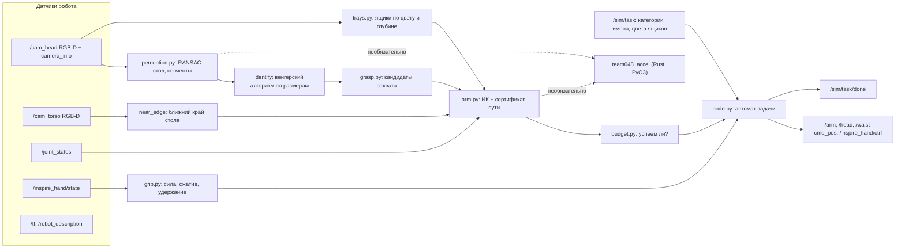

<p align="center">
  
  &nbsp;
  
  &nbsp;
  
  &nbsp;
  
  &nbsp;
  
</p>

<p align="center">
  
</p>

Русский | [English](README.en.md)

# DeftSort

Задача: ROS Humanoid Hack, трек манипуляции. Гуманоид TienKung 2.0 Pro с кистями Inspire стоит у стола в Isaac Sim 5.0 / Isaac Lab 2.2. На столе лежат предметы трёх категорий, рядом стоят цветные ящики. Нужно разложить предметы по ящикам своей категории: `sort2` (2 категории, лимит 270 с) и `sort3` (3 категории, 405 с) на пуле 3 (dish / box / jar), бонусом `sort2` на пуле 6. Время считается по часам симуляции, запуск входит в лимит. Предмет в своём ящике даёт +10, поднятый и оставленный вне ящика или в руке в конце даёт −10, нетронутый 0 (#595). Позы объектов из симулятора брать нельзя, координаты сцены зашивать нельзя (#645), самопересечения проверяются (#625).

DeftSort: один ROS 2-узел на Python за одну раскладку находит камерами робота стол и ящики, выделяет и опознаёт предметы, планирует захват и укладку с проверкой столкновений всего пути (рука, торс, другая рука, стол, стенки ящиков) и решает, успеет ли донести предмет до лимита. Без нейросетей: геометрия, RANSAC, венгерский алгоритм, DLS-ИК и сферическая модель робота. Числовые ядра продублированы в Rust-модуле `team048_accel`. На всех 62 записанных кадрах в целевой среде (Python 3.10, NumPy 1.26) депроекция, плоскость стола, ящики и сегменты совпадают с NumPy-эталоном бит-в-бит; признаки сегментов, кандидаты и планы отличаются не больше чем на 2.3e-14, дискретных различий нет.

| Звено | Вопрос | DeftSort |
|---|---|---|
| Сцена | Где стол и ящики? | RANSAC-плоскость по глубине головной камеры, ближний край по торсовой камере, ящики по цвету из `/sim/task` и глубине |
| Восприятие | Что лежит и где? | Сегменты над плоскостью, назначение объектам `/sim/task` по размерам (венгерский алгоритм) с отказом при малом зазоре |
| Захват | Как взять? | Сбоку поперёк узкой оси, щипок за бортик открытой посуды, сверху; двухфазное сжатие по совету #648 |
| Движение | Не задену ли себя и стол? | ИК по URDF и сертификат всего пути в пространстве суставов по сферам; торс из 64 сфер по мешу |
| Время | Успею ли до лимита? | Бюджет по `/clock`; проверка «нести или отпустить» до подъёма |

> Это рабочий репозиторий решения команды 048. Сдаётся отдельно, в командный репозиторий организаторов.

## Статус

В симуляторе решение набирает очки нестабильно. Офлайн-тесты зелёные. Изменения v12 и v13 проверены только на CPU: реплей записанных кадров и логов, стресс- и регрессионные тесты. GPU-квоты до 14.11 не осталось.

- Тесты: 190. С Rust-модулем и кадрами v7 проходят все 190; без кадров v7 — 174, 16 пропущено; с `TEAM048_ACCEL=0` — 167, 23 пропущено (тесты эквивалентности Rust ↔ NumPy). Фикстуры взяты из прогонов на Kaggle: кадры RGB-D, TRACE захватов, логи симулятора.
- Последний прогон, v11b (`sort2`, сид 101, код `497471e`): в ящиках 0 из 6. Сила дошла до обеих кистей, Threshold пропущен, но Utana выскользнула на переносе и осталась на столе (по кадрам, вероятно −10). Симулятор не ответил на `/sim/task/check`, точного счёта нет. Прогон до этого, v9b на `f525ed9`: 10 очков (Perricone).
- Тяжёлые предметы (от 0.22 кг) в v7 и v8 не удержаны ни разу (0 из 6), поэтому идут в конце очереди.
- Пробирки не решаются: узел сразу публикует `/sim/task/done` (0 очков, правилами допускается).

| Прогон (Kaggle T4, RTF ≈ 0.21) | Код | Итог | Что выяснилось |
|---|---|---|---|
| v6, sort3 × 3 сида | ранний | +10 на одном сиде | Первое наблюдение снималось до остановки головы; у правого ящика не было позы отпускания |
| v7, sort3 | после фиксов v6 | +10 на одном сиде | Стол в системе таза наклонён на 4°; большого пальца не было в модели столкновений, боковые захваты давили в стол |
| v8, sort3 сид 103 | yaw-укладка, новый стол | 10 (Perricone) | 4 из 5 подходов задевали предмет; Utana и горчица выскользнули при подъёме (сила 1.0) |
| v9a, sort3 сид 103, самопересечения ON | слияние compliance + Rust | 0 | Путь домой шёл до измерения стола и прошёл сквозь кромку (\|F\| до 938 Н); торса не было в модели |
| v9a, sort3 сид 103 | `f525ed9` | не запустился | Кадры камер пошли через 1115 с после старта моста, но стенд за 1512 с так и не получил `/sim/task` через `ros2 topic echo` |
| v9b, sort2 сид 101 | `f525ed9` | 10 (Perricone) | Сила кисти дошла только до правой руки; Threshold закрыт сверху, щипок за бортик 4 раза из 4 упирался большим пальцем |
| v11b, sort2 сид 101 | `497471e` | 0 в ящиках, вероятно −10 | Сила 0.4 на обеих кистях, Threshold пропущен; Perricone соскользнул при подъёме (тот же план, что в v9b); Utana удержана при подъёме и выпала на переносе |

Выводы из прогонов перенесены в код (у констант указан источник) и в регрессионные тесты `test_v8fixes.py`, `test_v9fix.py`, `test_audit.py`, `test_v10_*.py`, `test_v11.py`, `test_v12.py`, `test_v13.py`, `test_v14.py`.

## Содержание

- [Как устроено](#как-устроено)
- [Конвейер одной раскладки](#конвейер-одной-раскладки)
- [Безопасность движения](#безопасность-движения)
- [Захват](#захват)
- [Бюджет времени](#бюджет-времени)
- [Соответствие правилам](#соответствие-правилам)
- [Ускорение на Rust](#ускорение-на-rust)
- [Установка и запуск](#установка-и-запуск)
- [Тесты](#тесты)
- [Структура репозитория](#структура-репозитория)
- [Границы и план](#границы-и-план)
- [Документация](#документация)
- [Лицензии и происхождение](#лицензии-и-происхождение)

## Как устроено



| Модуль | Строк | Ответственность |
|---|---:|---|
| `node.py` | 903 | ROS-узел, автомат задачи, обзор сцены, исполнение, TRACE |
| `arm.py` | 583 | URDF, оболочки столкновений (рука, торс, голова, другая рука, бёдра, стол, ящики), облако раскрытой кисти, карта поз, планирование захвата и укладки |
| `perception.py` | 335 | Депроекция, RANSAC-плоскость стола, ближний край, сегментация по связности глубины |
| `planning.py` | 284 | Сферы, `CollisionModel`: `valid`, `certify`, `certify_escape` |
| `grip.py` | 273 | Сила и скорость кисти, двухфазное сжатие, охрана подхода, правило удержания |
| `kinematics.py` | 229 | Цепь из URDF, FK, якобиан, DLS-ИК с нуль-пространством |
| `trays.py` | 188 | Ящики по цвету и глубине: центр, ось, размер, высота стенок; места внутри |
| `_accel.py` | 151 | Переключатель Rust ↔ NumPy с автоматическим откатом |
| `grasp.py` | 135 | Кандидаты захвата по облаку: сбоку, бортик (только у открытой и не слишком тяжёлой посуды), сверху |
| `geometry.py`, `budget.py`, `sensing.py` | 95 / 85 / 46 | Геометрия, лимит времени, пары RGB-D по метке времени (под замком) |

## Конвейер одной раскладки

1. Старт. `run.sh` запускает узел с `use_sim_time:=true`. Узел ждёт `/sim/task` (latched) и `/clock`, считает `t0` с учётом возраста процесса `run.sh` (пессимистично, RTF ≤ 1). Задачи не из `sort2`/`sort3` сразу получают `/sim/task/done`.
2. Модель робота. Берётся `/robot_description`, если в нём есть все нужные звенья, иначе копия того же URDF организатора. Строятся две руки: 7-звенная цепь, ИК и сферическая модель.
3. Кисти. Запросы `set_force` 0.4 и `set_speed` 0.5 уходят каждой кисти сразу после старта, ещё до `/sim/task`. Фоновый поток ждёт появления сервиса, повторяет запрос, пока не придёт ответ (до 5 отправок через 2 с), и пишет в лог результат по каждой руке. Рука, до кисти которой ограничение силы не дошло, в захватах не используется. Затем кисти раскрываются, большой палец ставится в оппозицию.
4. Обзор сцены до первого движения рук. Голова наклонена на 0.4 рад и смотрит по yaw 0, +0.6, −0.6 рад. В каждом кадре ищутся плоскость стола (RANSAC в окне высот `[−0.45, −0.05]` м в системе таза) и ящики. Ящик, обрезанный краем кадра, снимается заново с доворотом головы. Ближний край стола измеряет торсовая камера.
5. Домой по проверенному пути. Обеим рукам задаётся измеренная сцена, затем каждая идёт домой по пути, сертифицированному против измеренного стола. Если стартовая поза уже касается модели, работает `certify_escape`, если прямой путь не проходит, ищется путь по карте поз (`roadmap_path`).
6. Цикл. Кадр RGB-D с одной меткой времени после остановки, сегменты над плоскостью без областей ящиков, сопоставление с объектами `/sim/task`. Порядок: сначала лёгкие (масса < 0.22 кг из `objects.yaml`), внутри группы по уверенности. Для каждого предмета: кандидаты захвата, план захвата и укладки (при необходимости с поворотом корпуса), проверка бюджета, исполнение.
7. Исполнение. Подход с охраной (последний отрезок 0.3 рад/с), большой палец, двухфазное сжатие, проверка «пусто?» без подъёма, повторная проверка времени, подъём, перенос, раскрытие, отход. После касания сцены кадр переснимается.
8. Конец. До двух неудач на предмет, затем один раунд повтора, если время позволяет. Руки домой, корпус в 0, `/sim/task/done`. В лог пишется строка `done at … reason: … fails …`.

## Безопасность движения

Самопересечения в физике симулятора отключены, но траектории проверяются, и проход руки «сквозь себя» аннулирует задачу (#623/#625/#628). Поэтому каждый командный путь проверяется до отправки.

- Сертификат пути `certify`. Путь в пространстве суставов проверяется сферами с гарантированным шагом: шаг пропускается только если доказано, что зазор не исчезнет. Запас `margin` 0.015 м.
- Что входит в модель. Сегменты руки и кисть со сферами большого пальца по мешу, колонна корпуса, 64 сферы торса по мешу `waist_yaw_link` (у крепления плеча исключены, остаётся 39 для левой и 42 для правой руки), голова, бёдра, другая рука в её измеренной позе, стол и стенки ящиков по измерениям. Внутрицепные пары кроме смежных тоже проверяются.
- Стол без выпуклости над кромкой. Большие сферы R = 0.1 начинаются от измеренной кромки + R, кромка из сфер r = 0.025, передняя грань колонной до 0.35 м ниже столешницы. Ни одна сфера не выходит за измеренную кромку.
- Выход из стартового касания `certify_escape`. Аналог `FixStartStateCollision` из MoveIt: пары, которые касаются уже на старте, могут только расходиться (допуск 1 мм), остальные проверяются обычным `certify`.
- Карта поз `roadmap_path`. Ленивая Dijkstra по сетке плечо × отведение × локоть, когда прямой путь домой не проходит.
- Руки не движутся одновременно, поэтому поза другой руки в модели неподвижна.

Цена модели торса измерена: на 100 раскладках пула 3 (`sort3`) достижимо в среднем 7.33 объекта на раскладку против 8.31 без торса. Примерно четверть отброшенных планов по мешу действительно касается торса ближе 5 мм, остальные отброшены с запасом (margin 0.015 + pad 0.005).

## Захват

| Совет организатора (#648) | Реализация |
|---|---|
| Сила 0.3–0.5 вместо 1.0 | `HAND_FORCE_RATIO` 0.4 на обе кисти с повтором до ответа сервиса; поворот большого пальца 1.0, он позиционирует, а не сжимает |
| Ниже скорость пальцев | `HAND_SPEED_RATIO` 0.5 (полный ход 1.6 с) |
| Сначала большой палец | Пальцы сжимаются, только когда `/inspire_hand/state` показывает DOF 6 в оппозиции |
| Цель «чуть за» предмет | Фаза 1: сжатие до остановки, измеряется контакт p_c. Фаза 2: цель p_c − `CLOSE_PAST` (0.15 хода) |

- Щипок за бортик только у открытой посуды (`grasp.rim_closed`). Если внутри окружности бортика облако стоит на высоте бортика, кандидатов на бортик нет. У Threshold в каждом кадре v7, v8 и v9b внутри 622–677 точек на высоте бортика, у открытой посуды 0–6. В v9b все 4 подхода к Threshold сработали на охране большого пальца: при каждой остановке кончик пальца был в 0.4–1.0 мм от точки на закрытом верху.
- Щипок за бортик только при моменте силы тяжести m·g·r ≤ 0.17 Н·м (`grasp.RIM_TORQUE_MAX`): m — масса опознанного предмета из `objects.yaml`, r — радиус бортика по измеренному контуру. В прогонах Ecoforms (0.05 Н·м) удержан 2 из 2, Threshold (0.11) 1 из 3, Utana (0.21–0.22 по реплею) 0 из 7. Посуда выше порога пропускается: 0 очков вместо риска −10.
- Посуда, взятая за бортик, ставится в слот центром, а не точкой щипка (`node.held_offset`). Раньше центр висел на r = 5–6.6 см от слота; для Ecoforms в среднем слоте край заходил на стенку ящика на 1.5 см (`test_v12.py`).
- Пустой захват распознаётся до подъёма (`contact_empty`, порог 0.10; в v7 пустой ≤ 0.03, с предметом ≥ 0.45). Предмет тогда не поднимается: 0, а не −10.
- Охрана подхода. Если раскрытый сжимающий палец отклонился от команды больше `GUARD_DEV` = 0.16, подход останавливается без сжатия. На v7 + v8 правило сохраняет 4 из 4 удержаний и ловит не меньше 10 из 12 неудачных подходов. Ложные срабатывания v9a (0.103 и 0.105) ниже порога.
- Правило удержания по пальцам: отклонение ≥ 0.10 и effort ≥ 0.9 (16 попыток v7 + v8 в фикстуре `v7v8_grasp_traces.json`). Датчик силы в запястье для этого непригоден: у пустой кисти он показывает от 0.05 до 5.5 Н в зависимости от позы.
- Физика. Привод пальцев в насыщении при силе 0.4 даёт не меньше 80 Н нормальной силы на палец; для самого тяжёлого предмета пула (горчица, 0.43 кг) хватает μ ≈ 0.03. Значит, срывы идут не от трения, а от геометрии: неантиподальная пара пальцев или контакт на подходе. У щипка за бортик Utana момент силы тяжести 0.23 Н·м против ≤ 0.11 Н·м у удержанных предметов.

## Бюджет времени

- Лимит: 270 с (`sort2`) и 405 с (`sort3`) по `/clock` от запуска `run.sh`.
- Начинать ли предмет (`can_start`): весь цикл должен уложиться в остаток с запасом `SAFETY_S` = 8 с. До первого измеренного цикла используется оценка `FIRST_CYCLE_S` = 35 с, хвост укладки `PLACE_TAIL_S` = 12 с.
- Нести или отпустить (`place_time`): после сжатия, до подъёма, ещё раз оценивается подъём, перенос, раскрытие и отход. Модель включает сам подъём и `MOVE_SETTLE_S` = 2.6 с доводки на каждое движение. Её откалибровали по TRACE v8: старая модель давала 6.6 с на отрезок «сжато → отпущено» при измеренных 12.0 с. Не успеваем, значит кисть раскрывается на месте.
- В чужой ящик ничего не кладётся. Ненайденный ящик означает пропуск категории.
- Любой исход заканчивается одинаково (v13): исключение в `pick_place` раскрывает обе кисти и уводит руки домой, прогон продолжается; в конце подъём, путь домой и возврат торса выполняются по отдельности, `/sim/task/done` публикуется всегда. Неудачное наблюдение повторяется один раз, а не обрывает прогон.

## Соответствие правилам

| Правило | Как выполнено | Чем проверено |
|---|---|---|
| Только датчики робота, без поз из симулятора (#595.1) | Узел подписан только на датчики и `/sim/task` | `test_node_stub.py`, `test_compliance.py`: список подписок и публикаций |
| Отладочные топики не используются | `/sim/task/check`, `/sim/objects/set`, `/sim/objects/randomize` не открываются | те же тесты |
| Нет координат сцены (#645) | Стол, кромка и ящики измеряются; в коде только окна поиска, размеры из документации и геометрия робота | `test_compliance.py`: проверка литералов раскладки по AST; `test_arm.py`: нет плана до измерения сцены |
| Самопересечения (#623/#625/#628) | Сертификат всего пути, торс по мешу, другая рука в измеренной позе, сертифицированный путь домой | `test_arm.py`, `test_v9fix.py` (фикстура v9a) |
| Сила кисти 0.3–0.5 (#648) | 0.4 на обе кисти, повтор до ответа, рука без ограничения силы не используется; двухфазное сжатие | `test_compliance.py`, `test_v8fixes.py`, `test_v11.py` |
| −10 за предмет вне ящика или в руке (#595.2) | `can_start` + `place_time` и худший случай `hold_time_bound` до подъёма; при исключении кисти раскрываются, руки домой | `test_compliance.py`, `test_audit.py`, `test_v13.py` |
| Лимит по времени симуляции, запуск входит (#595.3, #638) | `use_sim_time`, `launch_age_s` | `test_compliance.py`, `test_ideas.py` |
| Каждая раскладка в новом процессе (#636/#638) | Состояние только в памяти процесса | `test_node_stub.py` |
| `camera_info` и `/tf` (#554/#613) | K только из `camera_info`, поза камеры из `/tf` на метку кадра | `test_node_stub.py` на реальном кадре v5 |
| Без тяжёлых моделей | Нет нейросетей и GPU; `requirements.txt`: только `scipy==1.13.1` | — |

Полная матрица со ссылками на строки кода: [docs/ORG_ANSWERS.md](docs/ORG_ANSWERS.md), аудит констант сцены: [docs/COMPLIANCE.md](docs/COMPLIANCE.md).

## Ускорение на Rust

Крейт `rust/team048_accel` 0.2.0 (PyO3 0.30 abi3-py310, nalgebra 0.35, rayon). В нём FK, якобиан, DLS-ИК с SVD Якоби, `Arm.solve` целиком, проверка столкновений сферами и `certify`, депроекция глубины, RANSAC стола с тем же потоком PCG64, что у NumPy, маски, поиск ящиков, сегментация со статистиками компонент, калипер и зазоры пальцев.

| Замер (master `d96da87`) | NumPy-эталон | Rust | Ускорение |
|---|---:|---:|---:|
| Восприятие, мс на кадр | 146.7 | 47.9 | 3.1× |
| Планирование 10 объектов, с | 0.672 | 0.374 | 1.8× |

- Эквивалентность. `test_accel_equivalence.py` (8 тестов) и `test_accel_phase2.py` (15 тестов) сравнивают результаты бит-в-бит. Исключения: квантиль высоты сегмента (не больше 1e-12, FMA в BLAS NumPy) депроекция (не больше 1e-12, зависит от ядра OpenBLAS процессора) и решения ИК (не меньше 99.5 % случайных целей совпадают до 1e-9, в остальных обе ветки дают валидное решение). Сверка всех промежуточных величин на 62 кадрах (Python 3.10, NumPy 1.26): депроекция, плоскость, ящики, маски и сегменты идентичны; признаки сегментов до 5.6e-17, позы захвата и укладки до 2.3e-14; дискретных различий (выбор объекта, типа захвата, ящика, слота, вердикты столкновений) 0 из 5358. Отпечатки восприятия и планирования совпадают в режимах Rust и NumPy.
- Безопасный откат. Если модуль не установлен, старой версии или выдал ошибку, решение до конца процесса переключается на NumPy и даёт те же ответы. `panic = "unwind"`, чтобы паника в Rust стала исключением Python, а не падением узла.
- Поставка. `vendor/` содержит готовый wheel manylinux2014 x86_64, abi3 для CPython ≥ 3.10, с проверкой SHA256. AVX2-ядро включается только если процессор его поддерживает. Если wheel не встал, `setup.sh` собирает модуль из исходников через rustup и maturin. `setup.sh` никогда не завершается ошибкой.
- Потоки rayon выключены по умолчанию (`TEAM048_ACCEL_PARALLEL=1` включает): симулятор делит процессор с решением.

## Установка и запуск

Нужны ROS 2 Humble, Python 3.10 и пакет сообщений `bodyctrl_msgs` из симулятора организаторов.

```bash
pip install -r requirements.txt     # scipy (порядок установки формата: apt, pip, setup.sh, colcon build)
bash setup.sh                       # один раз, с интернетом: Rust-модуль из vendor/ или из исходников
colcon build                        # rust/ и vendor/ помечены COLCON_IGNORE
source install/setup.bash
bash run.sh                         # одна раскладка: ждёт /sim/task, раскладывает, публикует /sim/task/done
```

Проверка формата в чистом контейнере из корня репозитория симулятора: `bash hackathon/tools/solution.sh <путь к решению>`.

| Переменная | По умолчанию | Назначение |
|---|---|---|
| `TEAM048_HAND_FORCE` | 0.4 | Сила кисти (диапазон #648: 0.3–0.5) |
| `TEAM048_HAND_SPEED` | 0.5 | Скорость пальцев |
| `TEAM048_CLOSE_PAST` | 0.15 | Насколько сжимать «за» измеренный контакт |
| `TEAM048_ACCEL` | 1 | `0` отключает Rust-модуль |
| `TEAM048_ACCEL_PARALLEL` | 0 | `1` включает потоки rayon |
| `TEAM048_TRACE_DIR` | — | Только для отладки: JSON-трасса и кадры RGB-D по каждому объекту |

## Тесты

ROS для тестов не нужен: узел проверяется на заглушках с реальными кадрами симулятора.

```bash
python3 -m pytest -q                     # из корня (pytest.ini), с team048_accel, если установлен
TEAM048_ACCEL=0 python3 -m pytest -q     # только NumPy-эталон
cd rust/team048_accel && cargo test --release                     # ядра Rust и proptest
```

| Файл | Тестов | Что проверяет |
|---|---:|---|
| `test_ideas.py` | 40 | Бюджет и учёт запуска, вердикт по пальцам, ящики на реальном кадре, пары RGB-D, нуль-пространство ИК, FK головы против `/tf`, кандидаты захвата |
| `test_v8fixes.py` | 19 | Правило удержания, охрана подхода, заклинившие пальцы (фикстура v7 + v8) |
| `test_compliance.py` | 18 | Топики, отсутствие констант сцены (AST), #648, политика −10, лимит времени |
| `test_accel_phase2.py` | 15 | Бит-в-бит эквивалентность ядер фазы 2 |
| `test_v9fix.py` | 13 | Старт из позы v9a, `certify_escape`, модель стола, торс |
| `test_node_stub.py` | 12 | Проводка узла и наблюдение на реальном кадре v5 |
| `test_v11.py` | 10 | Доставка силы и скорости обеим кистям (фикстура логов v7–v9b), закрытый верх Threshold на кадре v9b |
| `test_v12.py` | 8 | Порог момента для бортика на кадрах v7 и v11b, укладка посуды центром в слот |
| `test_v13.py` | 9 | Пары RGB-D при параллельных колбэках, исключения в цикле задачи, повтор наблюдения |
| `test_v14.py` | 13 | Сила кисти 0.3–0.5 при любом переопределении, AST-проверка интерфейсов и запретов, `done` при ошибке настройки, `bgr8`, знак оси ящика |
| `test_v10_clear.py` | 10 | Облако раскрытой кисти, сдвиг центра захвата, чтобы кисть не задевала предмет |
| `test_yaw_release.py` | 10 | Пустая кисть на кадрах v7, раскрытие, укладка с поворотом корпуса в дальний ящик |
| `test_arm.py` | 8 | Пределы из URDF, FK/ИК, самопересечения, нет плана до измерения сцены |
| `test_accel_equivalence.py` | 8 | Эквивалентность FK, ИК, столкновений, RANSAC |
| `test_v10_budget.py` | 5 | Верхняя граница времени удержания предмета против TRACE v8 и таймаутов кода |
| `test_audit.py` | 5 | `place_time` против TRACE v8, порядок «сначала лёгкие», массы |
| Всего | 203 | |

Тесты эквивалентности на реальных кадрах v7 ищут их в `TEAM048_V7_TRACE` (по умолчанию `research/kaggle-sim/out_v7/trace` рабочего репозитория); в сдачу кадры не входят, без них эти тесты пропускаются.

## Структура репозитория

```text
.
├── run.sh, setup.sh, requirements.txt     # точки входа формата сдачи
├── src/team048_solution/                  # пакет ROS 2 (ament_python)
│   ├── team048_solution/                  # код узла, см. таблицу модулей
│   │   └── data/                          # URDF, сферы торса, геометрия кисти, priors (размеры и массы объектов)
│   └── test/                              # pytest + фикстуры из прогонов Kaggle (кадры, TRACE, позы)
├── rust/team048_accel/                    # Rust-крейт: src/{kin,col,perc,grasp,rng,py}.rs, benches, proptest
├── vendor/                                # готовый wheel team048_accel + SHA256SUMS
├── tools/                                 # офлайн: подгонка сфер по STL-мешам, геометрия кисти
└── docs/                                  # архитектура, соответствие правилам, параметры, чек-лист
```

## Границы и план

| Область | Сейчас | Следующий шаг |
|---|---|---|
| Проверка в симуляторе | v11b: сила обеим кистям и пропуск Threshold подтверждены; v12 на GPU не проверен | Прогон `sort2` сид 101 после сброса квоты: Utana пропускается, Ecoforms ставится центром в слот |
| Тяжёлые предметы | От 0.22 кг ни одного предмета в ящике за v7–v11b: без Utana 0 из 5 сжатий (Crunch, горчица, Crayola ×3); идут в конце очереди. При силе 0.4 (≈ 3.9 Н на палец) удержание требует μ ≥ m·g/(2N): 0.28 для Crunch, 0.64 для сахара; трения симулятора в данных нет | Захват тремя пальцами или за стенку у дна |
| Тяжёлая посуда | Utana (момент 0.21–0.22 Н·м) больше не берётся: 0 из 7 щипков, один вероятный −10 | Хват за стенку у дна или тремя пальцами |
| Соседние предметы | В v9b и v11b после касания Ecoforms (запястье до 26 Н) Ecoforms и Crunch опрокидывались; в v11b левая рука сдвинула Utana с края ящика на стол. Предметы в ящиках и на их краях в модели столкновений нет | Оболочка уложенных предметов |
| Выпавший предмет | Если предмет выпал на переносе, он считается уложенным и не повторяется; признак «пусто» над ящиком ненадёжен (v9b Perricone попал в ящик при вердикте «пусто») | Нужны данные о падениях |
| Модель торса | −1 объект на раскладку (8.31 → 7.33) | Уменьшить pad или margin только для торса после проверки |
| Пул 6 | Мышь Razer (10.0 см) и коробка желатина (8.9 см) шире раскрытия щипка (7.8 см), кандидатов нет | Отдельная стратегия захвата |
| Пробирки | Сразу `/sim/task/done` | После стабильной сортировки |
| Полезная нагрузка | Предмет в кисти не входит в модель столкновений; в переносе удержанный предмет терялся 2 раза из 3 (v9b Perricone, v11b Utana), связи со скоростью по этим данным не видно | Добавить оболочку предмета на переносе |
| PD-регулятор | Проверяется командный путь; реальный отстаёт у плеча до 15 % | Запас по TRACE |

## Документация

| Документ | Содержание |
|---|---|
| [docs/ARCHITECTURE.md](docs/ARCHITECTURE.md) | Жизненный цикл раскладки, модули, принципы |
| [docs/COMPLIANCE.md](docs/COMPLIANCE.md) | Соответствие правилам и ответам организаторов, аудит констант сцены, пробелы модели |
| [docs/ORG_ANSWERS.md](docs/ORG_ANSWERS.md) | Матрица «ответ организатора → код → тест» |
| [docs/MATH_PHYSICS.md](docs/MATH_PHYSICS.md) | Системы координат, депроекция, модель захвата и порог момента, ИК, столкновения, бюджет времени: формулы со ссылками на код |
| [docs/PARAMETERS.md](docs/PARAMETERS.md) | Каждый параметр и его происхождение: документация, робот, окно поиска, данные прогона, инженерный выбор |
| [docs/PREPUSH_CHECKLIST.md](docs/PREPUSH_CHECKLIST.md) | Чек-лист перед сдачей |

## Лицензии и происхождение

- Код команды: Apache-2.0, полный текст в `LICENSE` (указано также в `package.xml`, `Cargo.toml`).
- `data/tiangong_pro_with_hands.urdf` взят из репозитория симулятора (Apache-2.0, UBTECH / N. Semenov) и используется только как кинематическая модель робота.
- Сферы торса и большого пальца подогнаны офлайн (`tools/fit_spheres.py`, `tools/hand_from_meshes.py`) по STL-мешам UBTECH-Robot/tiangong2pro_tf (Apache-2.0).
- Чужой код не копировался. Идеи из открытых проектов UBTECH реализованы заново.
