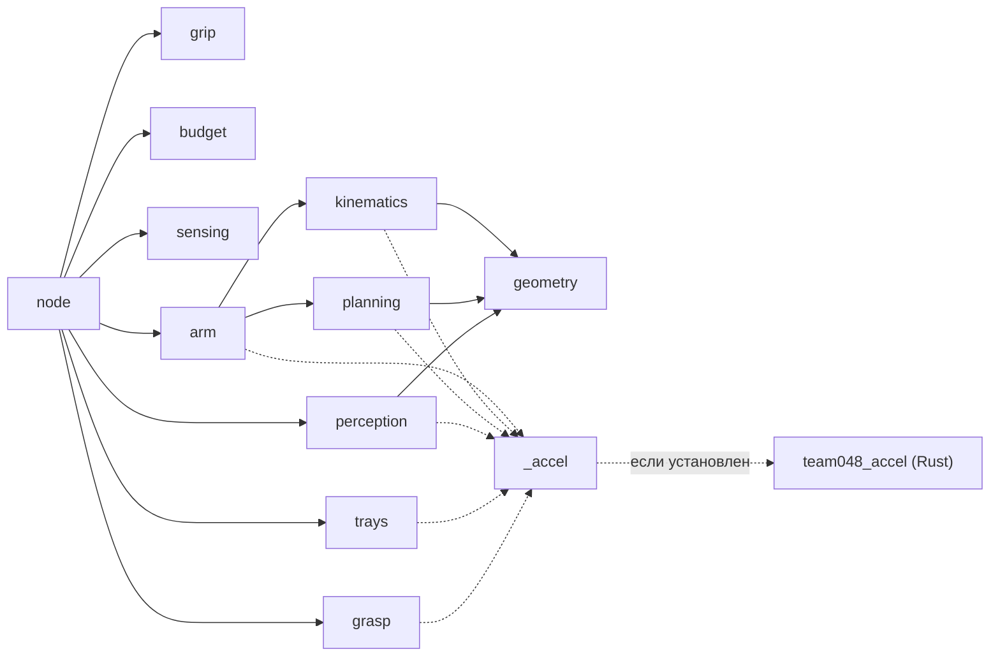

# Архитектура

Один пакет ROS 2 `team048_solution` (Python 3.10) и необязательный Rust-модуль `team048_accel` (PyO3) с копией числовых ядер. Без модуля работает эталон на NumPy с теми же ответами.

## Одна раскладка

1. `run.sh` подключает `install/setup.bash`, если каталог `install/` лежит рядом, и запускает `ros2 run team048_solution solution` с `use_sim_time:=true`.
2. Фоновый поток отправляет каждой кисти `set_force` и `set_speed`: ждёт сервис и повторяет запрос до ответа, не больше 5 отправок. Рука, у кисти которой сервис силы так и не нашёлся, в захватах не участвует.
3. Узел ждёт `/sim/task` (latched) и `/clock`. Начало отсчёта `t0` — запуск `run.sh` в секундах симуляции, с запасом. Для задач не из `sort2`/`sort3` сразу публикуется `/sim/task/done`.
4. Из `/robot_description` (если описание полное) строятся две руки: ИК и модель столкновений. Кисти раскрываются, большой палец уходит в оппозицию.
5. **Обзор.** Голова наклоняется на 0.4 рад и смотрит по yaw на 0, +0.6 и −0.6 рад. В каждом кадре ищутся плоскость стола и ящики; обрезанный краем кадра ящик снимается ещё раз. Ближний край стола даёт торсовая камера.
6. **Домой.** Обеим рукам задаётся измеренная сцена, и только потом руки идут домой по проверенному пути. Если стартовая поза уже касается модели, путь строит `certify_escape`; если прямой путь закрыт, `roadmap_path`.
7. **Цикл по предметам.** Кадр RGB-D с одной меткой времени после остановки головы. Сегменты над плоскостью без областей ящиков. Сопоставление с объектами `/sim/task` по размерам как задача о назначениях (`linear_sum_assignment`). Затем кандидаты захвата, план с проверкой всего пути и бюджет. Захват этого предмета, который уже исполнялся и не удался, идёт последним (`grasp.demote_failed`).
8. **Исполнение.** Подход, разворот большого пальца, сжатие в две фазы, проверка «пусто?» и проверка времени до подъёма. Потом подъём, перенос и раскрытие над ящиком, когда точка укладки внутри его прямоугольника (иначе один повторный подход, затем возврат на стол над местом захвата), и отход домой.
9. **Конец.** Руки домой, корпус в 0, `/sim/task/done` (один раз), выход. Если ошибка случилась вне цикла задачи, `done` публикует `main()`.

## Модули

| Модуль | Что делает |
|---|---|
| `node.py` | ROS-узел, автомат задачи, обзор сцены, исполнение, TRACE; после исключения раскрывает кисти и уводит руки (`recover`, `end_safe`) |
| `perception.py` | Плоскость стола (RANSAC с адаптивным числом выборок), ближний край, сегментация по связности глубины |
| `trays.py` | Ящики по цвету и глубине, слоты внутри ящика |
| `grasp.py` | Кандидаты захвата по облаку: сбоку, сверху, щипок за бортик открытой и не слишком тяжёлой посуды (`rim_closed`, `RIM_TORQUE_MAX`) |
| `grip.py` | Сила, скорость и сжатие кисти (#648), контроль касания при подходе, правило удержания |
| `arm.py` | URDF, оболочки столкновений (рука, торс, голова, другая рука, бёдра, стол, ящики), облако раскрытой кисти для сдвига центра захвата, план захвата и укладки |
| `kinematics.py`, `planning.py` | Цепь, FK, якобиан, DLS-ИК, сферы; `certify` — проверка всего пути с раздуванием сфер на ход сустава. Геометрию вне сферической модели она не видит |
| `budget.py` | Лимит по времени симуляции, решение «успеем ли» |
| `sensing.py` | Пары RGB-D по метке времени; буфер защищён блокировкой, колбэки камер идут в потоках исполнителя |
| `_accel.py` | Переключатель Rust ↔ NumPy с автоматическим откатом |

## Место среди решений

Конвейер повторяет классическую схему RoboCup@Home: плоскость стола через RANSAC, сегменты над ней, захваты сверху и сбоку по облаку (Cosero: Stückler, Schwarz, Behnke, Front. Robot. AI 2016). Поверх неё — приёмы победителей APC 2016 (Team Delft: Hernández Corbato et al., IEEE T-II 2018) и ARC 2017 (Cartman: Morrison et al., ICRA 2018):

- проверка удержания в две стадии: пальцы после сжатия, до подъёма, и отклонение пальцев с усилием после подъёма;
- новый кадр после касания и отложенный повтор;
- память неудачных захватов: на повторе идёт другой захват, а не тот же;
- адаптивное число выборок RANSAC (Hartley, Zisserman, 2004, ур. 4.18).

Код написан командой; из источников взяты идеи.

## Принципы

Сцену робот видит только своими датчиками: камерами, энкодерами и состоянием кистей. Её находят, а не помнят (#645).

Нет данных — нет действия. Нетронутый предмет стоит 0, поднятый и не донесённый −10. Поэтому пустая кисть, нехватка времени или отсутствие проверенного плана до подъёма означают «не поднимать».

Случайные числа идут с фиксированным сидом, сид раскладки не используется. Одинаковые кадры дают одинаковый план, и с Rust, и с NumPy.

На каждой фазе узел пишет JSON-строку TRACE: сила, пальцы, TCP план и факт. По этим строкам калибруются пороги.
