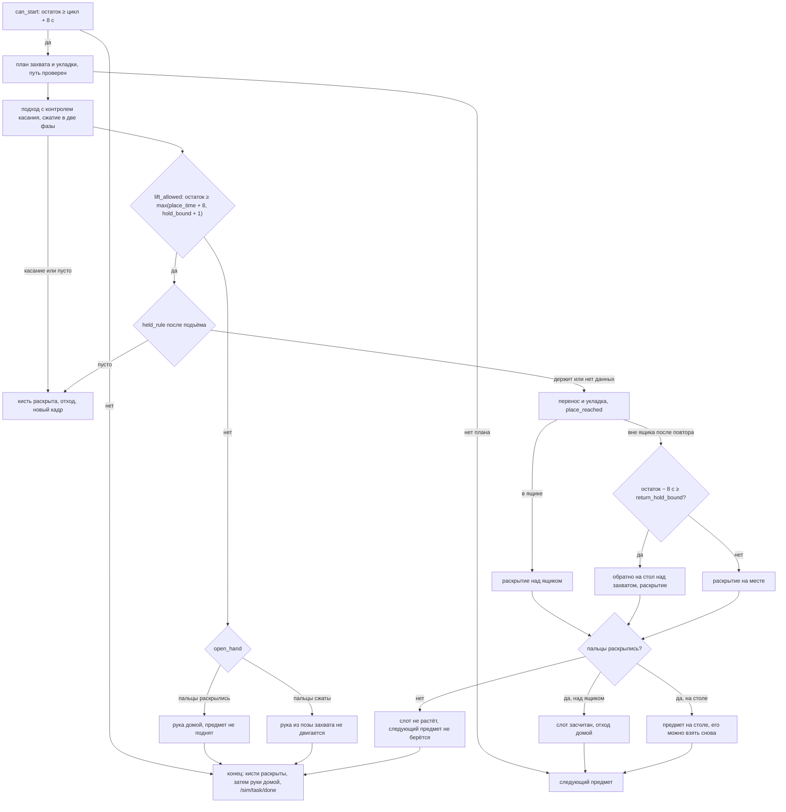

# Математика и физика решения

Здесь собраны формулы, по которым решение считает позы, захваты, столкновения и время. Ссылки вида `файл:строка` указывают на `src/team048_solution/team048_solution/`. Тесты свойств формул: `test/test_math.py`. Числа взяты из кода и из логов наших прогонов в симуляторе v5–v11b (см. README, раздел «Записанные прогоны»).

## 1. Системы координат

- Базовая система — `pelvis`: x вперёд, y влево, z вверх. Все облака, плоскость стола, ящики, позы TCP и сферы столкновений заданы в ней.
- Камера головы: `camera_head_link` (или `frame_id` кадра глубины), оптическая конвенция: x вправо по изображению, y вниз, z вдоль оси взгляда.
- Внешние параметры камеры берутся из `/tf` на момент штампа кадра, при отказе — последнее известное преобразование (`tf`, `node.py:422`). Кватернион переводится в матрицу стандартной формулой (`quat_to_T`, `node.py:99`):

  R = [[1−2(y²+z²), 2(xy−zw), 2(xz+yw)], [2(xy+zw), 1−2(x²+z²), 2(yz−xw)], [2(xz−yw), 2(yz+xw), 1−2(x²+y²)]].

  TF публикует единичные кватернионы, отдельной нормировки нет.
- Цепочка camera_head_link → голова → pelvis собирается в tf2, код только переводит итоговый кватернион в матрицу. Проверено по логу прогона v5 (`tf2_echo pelvis camera_head_link`, t = 62.17 с): кватернион [0.613, −0.613, 0.353, −0.353] даёт напечатанную матрицу с точностью печати (1.1·10⁻³), а FK по URDF при наклоне головы 0 совпадает с ней до 2.0·10⁻³. Ось взгляда (третий столбец R) смотрит вперёд и на 30° вниз, x изображения смотрит вправо (−y pelvis), y изображения — вниз. Это и есть оптическая конвенция, которую предполагает депроекция. Свойства R (ортогональность, det = +1, q и −q, композиция, обратное преобразование) проверены на случайных входах (`test_math.Transforms`).
- Внутренние параметры только из `camera_info` (`K`), без констант. В логах обе камеры (голова и торс) публикуют 640×360, f_x = f_y = 343.1635, c_x = 320, c_y = 180, D = 0. Отсюда горизонтальный угол обзора 2·atan(320/343.16) = 86.0°.
- Торс может поворачиваться (`body_yaw_joint`, ось z таза через его начало). Цепь руки строится с этим суставом в 0, поэтому при повороте на θ всё, что закреплено на тазе (стол, ящики, бёдра), рука видит повёрнутым на R_z(−θ). Сферы стола строятся в системе таза и только потом поворачиваются: ближний край стола — линия в системе таза, а не край повёрнутого торса. Торс, голова и вторая рука поворачиваются вместе с рукой и остаются на месте (`set_scene`, `_turned`). Цель укладки и высота стола задаются в повёрнутой системе (`plan_place_yaw`). После укладки с поворотом `go_home` и `retreat` проверяют путь при измеренном угле корпуса (`at_yaw`), а высоту TCP над столом сравнивают в системе таза.

## 2. Депроекция и стол

Пиксель (u, v) с глубиной d в мм (`node.py:453`, `deproject_py`, `perception.py:182`):

  Z = d/1000, X = (u − c_x)·Z/f_x, Y = (v − c_y)·Z/f_y, P_pelvis = R·[X, Y, Z] + t.

Нулевая глубина помечается невалидной (`dmm>0`) и дальше не используется. Обратная проекция точки в пиксель возвращает (u, v) и Z = d/1000 до 10⁻⁷ пикселя (`test_math.Pinhole`).

Соглашение о центре кадра: c_x = w/2 = 320 при отсчёте пикселей от центра пикселя 0. Если симулятор задаёт оптическую ось через геометрический центр кадра, то в соглашении ROS/OpenCV c_x = 319.5, и все точки сдвинуты на 0.5 пикселя. На 0.5–1.2 м это 0.7–1.7 мм. Это меньше допуска позиции TCP `TCP_TOL` = 1 см.

Плоскость стола (`table_plane`, `perception.py:64`):
1. RANSAC по тройкам точек, 120 итераций. Кандидат принимается, если нормаль после ориентации вверх имеет n_z ≥ 0.96 (наклон не больше 16°). На 62 кадрах наших прогонов (в репозиторий не входят) доля инлаеров стола в окне поиска w = 0.41–0.63. Вероятность, что за 120 итераций не попадётся ни одной тройки из одних инлаеров, равна (1 − w³)¹²⁰ ≤ 2.4·10⁻⁴; для 10⁻⁶ нужно 199 итераций. Если после 120 выборок доля инлаеров лучшего кандидата даёт вероятность промаха выше `RANSAC_MISS_MAX` = 10⁻³, тот же поток сида продолжается до N = ⌈ln 10⁻³ / ln(1 − w³)⌉ выборок, не больше 480 (Hartley, Zisserman, ур. 4.18). Первые 120 кандидатов те же, поэтому результат меняется, только если поздний кандидат строго лучше.
2. Инлаеры — точки ближе 6 мм.
3. Плоскость уточняется SVD по инлаерам: нормаль — последний правый сингулярный вектор (`_refine_plane`, `perception.py:190`).
4. Плоскость отбрасывается, если высота при x = 0.4 вне полосы поиска z ∈ [−0.45, −0.05] (`plane_plausible`, `arm.py:300`).

Высота точки над столом: h = n·p + d. Высота стола в точке (x, y): z = −(d + n_x·x + n_y·y)/n_z (`plane_height`, `arm.py:297`). Деления на ноль нет: n_z ≥ 0.96 проверено при измерении.

Ближний край стола берётся с камеры торса (`near_edge`, `perception.py:248`). Это 10-й перцентиль x по столбцам изображения, где под последним инлаером плоскости видно падение глубже 5 см. Если края не видно, используется консервативная граница `TABLE_X_NEAR_MIN` = 0.12 м.

Ящик: минимальный описанный прямоугольник по 91 углу (`trays.py`, `min_area_rect`). Протяжённости берутся по квантилям 2–98 % и делятся на 0.96. Это несмещённая ширина для равномерно покрытого отрезка. Из-за обрезки 2 % площадь почти не меняется в пределах нескольких градусов от истинного угла, а перебор берёт первый минимум. Поэтому ось ящика смещена: на синтетических ящиках 0.22×0.32 м медиана 1.7°, максимум 3.6°, это до 10 мм вбок на конце длинной стороны. Размер ошибается не больше чем на 3.2 мм. Ось ящика определена с точностью до знака, знак приводится к канону `trays.canonical_axis` (`trays.py:169`): a_y ≥ −1e-9, а при |a_y| ≤ 1e-9 — a_x ≥ 0.

## 3. Сегментация и опознание

- Сегменты — связные компоненты по 4-соседству со скачком глубины < 2.5 см, на высоте 1.2–35 см над столом. Узел берёт сегмент от 40 пикселей (`observe`, `node.py:476`); у `segment` (`perception.py:274`) порог по умолчанию 25. Пиксели внутри измеренных ящиков с запасом 3 см вычитаются (`tray_mask`).
- Признаки сегмента: высота q98, минимальный и максимальный размеры отпечатка по главным осям ковариации xy.
- Стоимость сопоставления с объектом из задания (`identify`, `node.py:554`):

  C = |h − h_p|/0.012 + max(0, w − w_p − 0.01)/0.012 + max(0, w_p − w − 0.02)/0.02 + max(0, l − l_p − 0.015)/0.015.

  Задача о назначениях решается `scipy.optimize.linear_sum_assignment` (модифицированный алгоритм Jonker–Volgenant, Crouse, 2016) с фиктивными столбцами стоимостью 3. Объект берётся, если запас до лучшей чужой категории больше 0.7 и C < 2.5.
- Объекты, которых нет в `priors.json` (незнакомые предметы бонусных пулов), не сопоставляются и не берутся: 0 очков, без штрафа.

## 4. Модель захвата

Кандидаты строятся по облаку сегмента (`candidates`, `grasp.py:108`).

- **Отпечаток** (`footprint`, `grasp.py:47`). Выпуклая оболочка xy, минимальная ширина перебором 180 направлений с шагом 1°, длина — по перпендикуляру. Ширина оболочки не меньше истинной и не больше w + L·sin 0.5° (для L = 0.2 м это +1.7 мм, `test_math.Rectangles`).
- **Боковой захват** (коробки, банки). Сжатие поперёк ширины, если w + 2·0.01 ≤ W_max. Подход идёт со стороны робота, высота захвата z = max(h/2, min(0.04, h − 0.01)). Для банки ширина уточняется окружностью по срезу на половине высоты (МНК Kåsa, `circle_fit`, `grasp.py:59`), если невязка < 4 мм.
- **Захват сверху** (коробки). Щипок с глубины 3 см под верхом.
- **Щипок за бортик** (посуда). По оболочке строится окружность (c₀, r₀), точки щипка лежат на ней под углами 0, ±30°, ±60°, ±90° от направления на робота. Ось сжатия радиальная, глубина 1.5 см под верхом.
- **Закрытый верх** (`rim_closed`, `grasp.py:71`). Если медиана высоты точек глубже r₀ − 2.5 см лежит выше уровня щипка, посуда считается закрытой и не берётся за бортик.
- **Порог момента** (`RIM_TORQUE_MAX`, `grasp.py:34`; присвоение момента в `candidates`, `grasp.py:138`). Пальцы держат посуду за одну точку бортика, поэтому сила тяжести создаёт момент относительно щипка:

  M = m·g·r₀, m — масса опознанного объекта из `objects.yaml`.

  Щипок разрешён при M ≤ 0.17 Н·м. Единицы: кг · м/с² · м = Н·м; масса берётся из `priors.json` (копия `objects.yaml`), r₀ — из окружности Kåsa по оболочке: x² + y² = 2ax + 2by + c, r² = c + a² + b². Номинальные значения: Utana 0.35 кг · 9.81 · 0.066 м = 0.227, Threshold 0.20 · 9.81 · 0.056 = 0.110, Ecoforms 0.10 · 9.81 · 0.0505 = 0.050. Порог стоит посередине между Threshold (0.11) и Utana (0.23 по номинальному радиусу) и откалиброван по записанным щипкам за бортик.
- **Зазор пальцев до соседей.** Точки других сегментов должны быть дальше 2 см от концов пальцев.

Поза TCP строится из оси сжатия u и направления подхода a (`grasp_pose`, `arm.py:564`):
1. Подход ортогонализуется: a' = (a − u(a·u))/|…|.
2. Базис руки B = [u, a', u×a'], поворот R = B·Aᵀ, где A — тот же базис кисти в системе TCP.
3. Положение: p_TCP = c − R·g_t, g_t — точка захвата в TCP. Для щипка это точка встречи большого и указательного пальцев по мешам.

Сдвиг открытой кисти (`grasp_clear_shift`, `arm.py:170`). Точки меша открытой кисти переносятся в систему объекта. Ищется минимальный отвод назад dr (затем минимальный |du| вдоль оси сжатия), при котором ни одна точка кисти не входит в измеренный короб объекта с запасом 4/2/0 мм — ни в позе захвата, ни на последних 8 см подхода с шагом 1 см.

Укладка посуды центром (`held_offset`, `node.py:940`; `plan_place`, `node.py:959`). Центр посуды в системе TCP: o = R_gᵀ(c₀ − p_g). Поза над слотом сдвигается по горизонтали на s = R·o + p − c, чтобы над слотом оказался центр посуды, а не точка щипка.

## 5. Пальцы, сила, проверка удержания

- Сила `SetForce` 0.4 на сгибание пальцев (DOF 1–5), 0.5 на поворот большого пальца (DOF 6, он ставит палец в оппозицию); все шесть каналов в пределах 0.3–0.5. Скорость 0.5 — полный ход 1.6 с (`grip.py:48-52`).
  - По INTERFACES 1.0 = 1000 г. Тогда 0.4 ≈ 3.9 Н на палец. Мануал Inspire RH56 (открытые источники) уточняет две вещи. Во-первых, FORCE_SET — это порог остановки пальца, а не регулятор силы: палец останавливается, когда измеренная сила дойдёт до порога. Во-вторых, независимая калибровка реальной кисти (arXiv 2603.08988) даёт меньше паспорта: 400 единиц ≈ 2.6 Н на указательном и ≈ 5.4 Н на сгибе большого пальца. Для симулятора действует его собственная модель: effort = |τ|/(lim0·r), с обрезкой до 1.
  - При двустороннем трении удержание требует μ ≥ m·g/(2N): Perricone (0.08 кг): μ ≥ 0.10; Crunch (0.22 кг): μ ≥ 0.28; Crayola (0.35 кг): μ ≥ 0.44; сахар (0.51 кг): μ ≥ 0.64.
  - Коэффициента трения симулятора в данных нет, поэтому это нижние оценки. По открытым источникам, в PhysX 5.6 осталась только patch-модель трения, а комбинация μ пары материалов по умолчанию `average`.
- Канал поворота большого пальца (DOF 6) ставит палец в оппозицию до сжатия: по строкам HAND (10 Гц) в v9b и v11b позиция держится у цели 0 с отклонением ≤ 0.011, а в первом отсчёте close1 (перед сжатием) равна 0 во всех 10 захватах (`wait_thumb` = True). При щипке канал несёт боковую реакцию предмета, поэтому он получает верхнюю границу диапазона, 0.5.
- Двухфазное сжатие (`grasp_close`; `contact_target`, `grip.py:103`):
  1. Пальцы закрываются до остановки. Остановка — каждый палец сдвинулся меньше 0.005 за 0.15 с.
  2. Цель ставится на 0.15 хода дальше точки контакта. Пальцы, отогнутые за 1.02 (заклинившие), не перенацеливаются.
- Пустой захват до подъёма: средний остаток хода < 0.10 → кисть открывается, объект не поднят (0 очков).
- Правило удержания после подъёма (`held_rule`, `grip.py:127`): хотя бы один сжимающий палец отстаёт от команды на ≥ 0.10 при усилии ≥ 0.9. На v7+v8 правило дало 15 верных ответов из 15.
- Контроль касания при подходе (`approach_deviation`, `grip.py:156`): отклонение сжимающего пальца от открытой команды > 0.16 означает касание. Кисть не сжимается, рука уходит вверх.

## 6. Обратная кинематика

Кинематика — DLS с весами и запасной траекторией (`_ik_loop`, `kinematics.py:211`):
- Невязка e = [p* − p, θ(R*Rᵀ)], вес поворота 0.25 м/рад.
- Шаг: Δq = V·diag(s/(s² + λ²))·Uᵀ·W·e, демпфирование λ = 0.002 + 0.05·max(0, 1 − s_min/0.04)².
- Шаг ограничен 0.15 рад и принимается только если невязка уменьшилась (линейный поиск 1 … 1/64).
- Избыточная 7-я степень: к шагу добавляется 0.1·N·(q_home − q), N = I − V_rᵀV_r — проектор на ядро якобиана.
- Сходимость: 2 мм и 0.015 рад. Иначе исключение, и поза не используется.
- Каждый шаг обрезается по пределам суставов из URDF (`np.clip(q, lower, upper)`). Невязка поворота — логарифм SO(3), включая θ = π. Проверено на случайных входах: θ·a для θ ∈ (0, π], сходимость внутри пределов из 25 случайных поз (`test_math.Kinematics`).

Коррекция TCP перед сжатием (`correct`, `arm.py:551`): Δq = Jᵀ(JJᵀ + 10⁻⁴I)⁻¹·e, шаг не больше 0.05 рад, затем проверка столкновений.

## 7. Столкновения

- Рука, кисть, большой палец, торс (сферы по мешу), голова, другая рука в её измеренной позе, бёдра, стол и стенки ящиков — всё сферы в `pelvis` при нулевом повороте корпуса (`arm_spheres`, `arm.py:201`; `body_env`, `arm.py:248`; `table_env_build`, `arm.py:319`; `tray_env_build`, `arm.py:352`).
- Поза допустима, если для каждой пары |c_i − c_j| > r_i + r_j + 0.015 м (`valid_vec`, `planning.py:135`). `valid` вызывает её.
- Путь в пространстве суставов проверяется дискретно с шагом ≤ 0.003 рад и раздуванием каждой сферы на L·|Δq|/n, L — плечо сферы относительно сустава (`certify`, `planning.py:160`). Так между проверками сфера не может «проскочить» препятствие. Оценка L = Σ|origin| + |c| — верхняя граница расстояния центра сферы от оси сустава, а сдвиг ≤ L·|Δθ| (хорда ≤ дуги). Раздувание на полный шаг вдвое осторожнее нужного (достаточно половины). Неравенство |Δc| ≤ L·|Δq| проверено на 100 случайных шагах (`test_math.Kinematics`).
- Старт внутри запаса (`certify_escape`, `planning.py:187`): пара, уже внутри запаса, может сблизиться не больше чем на `ESCAPE_TOL` (1 мм). Пара, которая в старте ещё свободна, в том числе если зазор меньше одного шага раздувания, остаётся строго свободной на всём отрезке. Если в стартовом множестве оказались все сферы сцены, самопересечения звеньев проверяются отдельно.
- Поворот корпуса с предметом (`certify_turn`): рука держит позу q, корпус поворачивается от 0 до θ. Центр сферы руки c идёт по дуге вокруг оси z таза, |R(a)c − R(b)c| ≤ ρ·|a − b|, ρ — расстояние центра от оси (хорда ≤ дуги). Углы берутся с шагом Δa, при котором ρ_max·Δa ≤ 5 мм (`TURN_STEP`), и каждая сфера раздувается на свои ρ·Δa. Так проверена вся дуга, а не отдельные углы. Проверяются пары с частями, закреплёнными на тазе (стол, ящики, бёдра). Пары, которые ни на одном угле не сходятся по высоте или по расстоянию от оси, отбрасываются заранее. Раньше поза проверялась в 5 углах: между ними было до 0.6 рад, а полоса стенки ящика на радиусе кисти — около 0.15 рад (`test_yaw_release.TurnSweep`). Домашняя поза обеих рук проходит весь диапазон ±2.5 рад, поэтому корпус возвращается в 0 после `go_home`.
- Доводка, если за отведённое время цель не достигнута, не прибавляет к команде весь остаток. Застрявшая рука получила бы цель q + (q − q_now), то есть ещё один такой же отрезок за концом проверенного пути и глубже в препятствие. Сдвиг ограничен `MOVE_RES` (0.06 рад) и отправляется, только если `certify` принимает отрезок от измеренной позы до этой команды при измеренном угле корпуса (`at_yaw`). Иначе повторяется исходная цель. Скорости доводки снова пропорциональны хода́м суставов, с потолком 0.3 рад/с: одинаковые 0.3 рад/с на все суставы оставляют короткий сустав на месте, пока длинный ещё едет, и рука сходит с проверенной прямой. Коррекция TCP перед раскрытием над ящиком проверяется так же: коррекция, посчитанная при нулевом угле, на повёрнутом корпусе проходит сквозь стенку ящика (`test_yaw_release.CorrectionYaw`).
- Исполнение — синхронное движение по прямой в пространстве суставов: скорость сустава v_i = v_max·|Δq_i|/max|Δq| (`move_arm`, `node.py:213`), то есть команда идёт ровно по проверенному отрезку. Нижней границы скорости, кроме 10⁻³ рад/с в `cmd` (0 симулятор понимает как максимум), нет. Прежняя граница 0.05 рад/с уводила почти неподвижные суставы с отрезка: сустав с Δq_i < 0.0625·max|Δq| приходил раньше остальных, отклонение доходило до Δq_i. Теперь раньше приходит только сустав с Δq_i < 10⁻³·max|Δq|/v_max, и уход от отрезка не больше 10⁻³·max|Δq|/v_max рад. При 0.8 рад/с даже ход на весь диапазон сустава (5.93 рад) даёт не больше 6.6 мм на самом длинном рычаге модели (0.89 м), и это внутри запаса 15 мм. Подход на 0.3 рад/с — короткий последний отрезок, не ход на весь диапазон.
- Не моделируются: удерживаемый объект, уже уложенные предметы и предметы на краю ящика (см. раздел «Границы» в README).

## 8. Бюджет времени

Решения по времени и удержанию на одном предмете (`node.py`, `pick_place`):

- Отсчёт от запуска `run.sh` (`start_time`, `budget.py:48`): t₀ = t_sim − (t_wall_ready − t_wall_launch), при RTF ≤ 1 оценка пессимистична.
- Новый объект начинается, если остаток ≥ оценка цикла (EMA с мгновенным ростом) + 8 с (`can_start`, `budget.py:42`).
- Подъём разрешён, только если остаток ≥ max(place_time + 8, hold_bound + 1) (`lift_allowed`, `node.py:1075`):
  - place_time — типичное время: Σ(1.6·max|Δq|/0.8 + 2.6) по движениям, поворот торса 2θ/0.8 + 1, раскрытие 2.1 с (`place_time`, `node.py:1034`);
  - hold_bound — худший случай всего, что происходит с предметом в руке, когда каждый шаг уходит в таймаут (`hold_time_bound`, `node.py:1047`): движения подъёма, переноса и укладки Σ(1.6·(max|Δq| + 0.06)/0.8 + 2 + 2·1.5) плюс пауза 0.3 с; 6 с на поворот корпуса; коррекция укладки 1.6·(0.15 + 2·0.06)/0.8 + 2 + 1.5 = 4.04 с; на каждый из `PLACE_RETRIES` повторных подходов движение к позе укладки 1.6·(0.15 + 2·0.06)/0.8 + 2 + 2·1.5 = 5.54 с и ещё одна коррекция 4.04 с; двойное раскрытие 2·1 с. Повторный подход начинается с команды коррекции, которая лежит в пределах шага 0.15 рад от позы укладки, плюс остаточная ошибка 0.06 рад.

  Так подъём, перенос, укладка с коррекцией, повторный подход и раскрытие укладываются в лимит 270/405 с, даже если каждый из этих шагов уходит в таймаут. Обратный путь к месту захвата (`release_off_tray`, `return_hold_bound`) запускается, только если остаток минус 8 с покрывает его худший случай: каждое `move_arm` по `move_bound`, поворот корпуса по `WAIST_TMAX`, два ожидания `RELEASE_WAIT`. Иначе кисть раскрывается там, где стоит. Если после команды раскрытия над ящиком или на обратном пути пальцы так и читаются сжатыми, укладка не засчитывается и `go_home` из этой укладки не вызывается: цикл по предметам останавливается. Нехватка времени до подъёма тоже идёт через `open_hand`. Пальцы, которые не читаются сжатыми (раскрыты или измерения нет), — `retreat` и возврат None, следующий предмет не берётся. Сжатые пальцы из позы захвата не уводятся: `retreat` поднял бы предмет. В конце прогона `end_safe` ещё раз раскрывает обе кисти и только потом двигает руки, даже если пальцы так и не раскрылись.
- Проверка укладки (`node.in_tray`, `node.release_xy`): точка предмета p = R_z(θ)·(T·o), где T — TCP по измеренным суставам, o — центр предмета в системе TCP (щипок за бортик) или точка захвата, θ — поворот торса. Точка внутри ящика, если |(p − c)·a| ≤ L/2 и |(p − c)·a⊥| ≤ S/2 (c, a, S×L — измеренные центр, длинная ось и размер). Кисть раскрывается, если ошибка TCP ≤ `PLACE_TOL` или точка внутри.
- Исключение внутри `pick_place` не обрывает прогон. Кисти раскрываются, руки уходят домой (`recover`, `node.py:678`). В конце сначала раскрываются кисти, затем каждый шаг (подъём, домой, торс) выполняется отдельно, поэтому сбой одного шага не мешает опубликовать `/sim/task/done` (`end_safe`, `node.py:663`).

## 9. Потоки

- Колбэки ROS идут в потоках `MultiThreadedExecutor`, логика задачи — в главном потоке. Каждый колбэк обёрнут в `Sol.guarded`: сообщение, на котором колбэк бросил исключение, пишется в лог и отбрасывается, исполнитель продолжает работу. `/sim/task` принимается только как JSON-объект (`Sol.on_task`).
- Буфер кадров RGB-D читается копией под замком (`snapshot`, `sensing.py:32`): итерация по `deque`, в который пишет другой поток, бросает `RuntimeError` (стресс-тест в `test_run_robustness.py` воспроизводит эту ошибку на итерации без замка).
- Доставка `SetForce`/`SetSpeed` идёт в фоновом потоке. Состояние — словарь, главный поток его только читает (`node.py`, `hand_settings_step`).
- История кисти (`hpos`, `hvel`) заменяется атомарно кортежем, а не дописывается в список, по которому идёт итерация в главном потоке (`test_topics_motion.HandHistory`). Если в `/joint_states` нет нужного сустава, `q_now` пишет в лог и бросает `JointStateMissing` вместо подстановки нуля. Ожидание `/joint_states` ограничено бюджетом (`budget.can_start`), кадр для захвата берётся не старше 2 периодов камеры (0.06 с сим-времени, `CAPTURE_MAX_AGE`).
